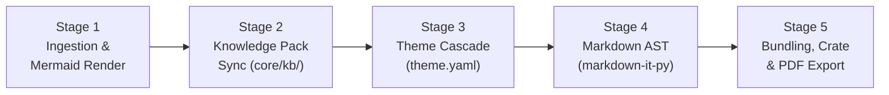

# AGENTS.md — Agent Operating Guide for `md-style`

Welcome, AI Agent! This document provides the architectural guidelines, mental models, CLI workflows, invariant constraints, and troubleshooting tips you need to safely and productively navigate, modify, and extend the `md-style` codebase.

---

## 1. What is `md-style`?

`md-style` (v3.0.0) is a **pure-Python, publication-grade document generation and knowledge packaging toolkit**. It compiles Markdown into:
1. **Self-Contained Interactive HTML Reports** with embedded Svelte HUD overlays, expandable knowledge drawers, inline callouts, and Google Docs-style collaborative margin comments.
2. **Pixel-Perfect PDF Reports** matching W3C `@media print` and Paged.js page geometry specifications via Chromium headless printing or Bun CDP bridge.
3. **Standard RO-Crate Research Object Packages (`.crate.zip`)** compliant with RO-Crate v1.1 and JSON-LD schema metadata for reproducible forensic and administrative audits.

---

## 2. Fundamental Architectural Invariants

Whenever you read, edit, or test code in this repository, you **MUST** respect the following invariants:

1. **Zero Pandoc Dependency (Pure Python v3)**:
   * The pipeline does **NOT** invoke `pandoc` or external binary document compilers.
   * Markdown AST parsing is handled by `markdown-it-py` with custom pure-Python plugins (`core/parser/`).
   * Templating is powered by Jinja2 and Rich.
2. **100% Offline Air-Gap Safety**:
   * All entity resolvers (`core/kb/resolvers/`) must function safely in an offline air-gapped environment using local Single Source of Truth (SSOT) databases (`data/statutes.json`, `core/kb/resolvers/`) or local caches.
   * Any dynamic web scraping (e.g. *Zákony pro lidi*, NVD, AbuseIPDB) **MUST** be gated behind `allow_online: bool = False` or `--offline`.
3. **Single-File Self-Contained Output**:
   * The bundled `.html` must remain 100% standalone and portable.
   * All fonts (`core/fonts.py`), CSS stylesheets, SVG diagrams, and JSON metadata are inlined into the HTML. Opening the file with `file://` in any browser with networking disabled must render flawlessly.
4. **Source Reversibility**:
   * Bundled HTML reports contain the original Markdown source inside `<script type="text/markdown" id="report-markdown-source">` and the Knowledge Pack inside `<script type="application/json" id="knowledge-pack">`.
   * CLI tools (`md-style preview`, `md-style inspect`) can de-bundle and preview HTML files directly.

---

## 3. High-Level Pipeline Architecture

The document compiler runs a sequential 5-stage pipeline (`core/engine.py`):



* **Stage 1 (Ingestion & Diagrams)**: Normalizes nested containers, parses frontmatter (`core/frontmatter.py`), renders Mermaid code blocks to SVG via `beautiful-mermaid`.
* **Stage 2 (Knowledge Pack Sync)**: Discovers indicators in text (CVEs, IPs, hashes, statutes, IČO, IBAN), resolves them against local/cached knowledge bases, and computes SHA-256 integrity digests (`core/kb/`).
* **Stage 3 (Theme Resolution)**: Resolves the declarative inheritance chain from `base` down to the leaf theme (`styles/**/theme.yaml`), merging CSS custom properties, Paged.js page geometry, and feature flags (`core/themes.py`).
* **Stage 4 (AST Compilation)**: Transforms Markdown tokens into semantic HTML with custom callouts, table wrappers, footnotes, and pill-wrapped entity spans (`core/parser/`).
* **Stage 5 (Bundling & Export)**: Inlines fonts (base64 WOFF2), injects the Svelte viewer bundle (`core/assets/viewer.bundle.js`), packages RO-Crate archives, or invokes headless Chromium for direct PDF export.

---

## 4. Directory Structure

```text
md-style/
├── core/                         # Core Python pipeline
│   ├── assets/                   # Bundled viewer.bundle.js and viewer.bundle.css
│   ├── bundler.py                # Single-file HTML inliner and font processor
│   ├── cli.py                    # Main CLI entrypoint (build_parser, routing)
│   ├── config.py                 # Paths, cache directories, environment defaults
│   ├── crate.py                  # RO-Crate 1.1 JSON-LD packager and verifier
│   ├── diagnostics.py            # Rich logging, terminal tables, pipeline timers
│   ├── diagrams/                 # Mermaid diagram renderer bridge
│   ├── engine.py                 # 5-stage ReportEngine pipeline coordinator
│   ├── fonts.py                  # Offline font cache and base64 inliner
│   ├── frontmatter.py            # YAML frontmatter parser and validator
│   ├── i18n/                     # Layered catalog localization engine
│   ├── inspector_cli.py          # Terminal Knowledge Pack inspector
│   ├── kb/                       # Knowledge Pack lifecycle, models, and resolvers
│   │   ├── models.py             # KnowledgeEntity, KnowledgePack, Provenance
│   │   ├── sync.py               # Authoritative catalog synchronizer
│   │   └── resolvers/            # Specialized indicator resolvers (CVE, Statute, ICO, IBAN...)
│   ├── parser/                   # Pure-Python Markdown parser (markdown-it-py plugins)
│   ├── preview_cli.py            # Terminal Markdown, HTML, and RO-Crate previewer
│   ├── theme_tool.py             # Theme Inspector, Linter, and Scaffolder
│   └── themes.py                 # ThemeResolver with cascading inheritance
├── data/                         # Offline SSOT catalogs (statutes.json, etc.)
├── styles/                       # Declarative theme suites (theme.yaml + CSS)
│   ├── base/                     # Universal root theme (fonts, paged base, reset)
│   ├── forensic/                 # DFIR investigation styles (cyber, dossier)
│   ├── svj/                      # Condominium / HOA styles (base, invitation, ballot)
│   ├── general/                  # Announcement, school, family-invite
│   └── i18n/                     # Domain-specific localization catalogs (cs, en, sk, de)
├── viewer/                       # Svelte 5 interactive viewer client
│   ├── src/                      # Svelte components (annotations, HUD, drawer, widgets)
│   └── package.json              # Bundled via Vite / Bun
└── tests/                        # Comprehensive Pytest test battery
```

---

## 5. CLI Command Reference & Cheat Sheet

All commands are executed using `uv run md-style` (or `./md-to-report.sh`):

### Compilation & Document Generation
```bash
# Compile self-contained interactive HTML:
uv run md-style report.md -s forensic/cyber -o output.html

# Compile direct high-fidelity PDF via headless Chromium:
uv run md-style report.md -s svj/invitation --pdf -o output.pdf

# Package as RO-Crate 1.1 archive with digital evidence:
uv run md-style report.md -s forensic/cyber --crate --evidence ./evidence/ -o case.crate.zip

# Verify an existing RO-Crate archive:
uv run md-style --verify-crate case.crate.zip

# Force incremental or authoritative Knowledge Pack refresh:
uv run md-style report.md --kb-refresh
uv run md-style report.md --kb-refresh=sources
```

### Terminal Markdown & Bundle Previews
```bash
# Preview raw Markdown in the terminal:
uv run md-style preview document.md

# Preview Markdown source embedded inside a bundled HTML report:
uv run md-style preview bundled-report.html

# Preview Markdown directly from inside an RO-Crate ZIP:
uv run md-style preview case.crate.zip --page
```

### Knowledge Pack Terminal Inspector
```bash
# Inspect all entities in a Knowledge Pack or document:
uv run md-style inspect report.md
uv run md-style inspect output.html

# Drill down into a specific token:
uv run md-style inspect output.html CVE-2024-3094
uv run md-style inspect report.md "§ 1180"
```

### Theme Inspector, Linter & Scaffolder
```bash
# List all discovered themes and page formats:
uv run md-style theme list
# (or: uv run md-style --list-styles)

# Deep-dive inspection of a theme's cascade, variables, and Paged geometry:
uv run md-style theme inspect forensic/cyber
# (or: uv run md-style --theme-inspect svj/invitation)

# Static audit and linting across all themes or a specific style:
uv run md-style theme lint
# (or: uv run md-style --theme-lint forensic/cyber)

# Scaffold a new starter theme:
uv run md-style theme new custom/corporate --extends base
# (or: uv run md-style --theme-new custom/corporate)
```

### Catalog & Resolver Discovery
```bash
# List all registered artifact extractors and indicator providers:
uv run md-style --list-artifacts
```

---

## 6. How to Extend the Codebase

### 1. Adding a New Knowledge Entity Resolver
1. Create `core/kb/resolvers/<name>_resolver.py`.
2. Implement extraction regex / pattern matching and resolution logic.
3. Return a `KnowledgeEntity` with `id`, `type`, `title`, `domain`, `summary`, `attributes`, and `provenance`.
4. Register the resolver in `core/kb/resolvers/__init__.py`.
5. Add unit tests in `tests/test_kb_resolvers.py`.

### 2. Adding a New Theme
1. Run `uv run md-style theme new <family>/<name> --extends <base|ancestor>`.
2. Customize `styles/<family>/<name>/theme.yaml`:
   * Set `variables` for colors, borders, and typography.
   * Set `paged` paper size, margins, and running header/footer templates.
   * Toggle `features` (`interactive_viewer`, `callouts`, `sticky_tables`, etc.).
3. Write CSS rules in `styles/<family>/<name>/<name>.css`.
4. Validate your theme using `uv run md-style theme lint <family>/<name>`.

### 3. Modifying the Interactive Svelte Viewer
1. Viewer source files are located in `viewer/src/`.
2. After editing Svelte components, recompile the asset bundle:
   ```bash
   cd viewer && npm run build
   ```
   *(This updates `core/assets/viewer.bundle.js` and `core/assets/viewer.bundle.css`)*.
3. Verify changes using `uv run md-style examples/sample-forensic-cyber.md -o test.html`.

---

## 7. Testing & Verification

Always run the test suite to ensure no regressions:

```bash
# Run unit and integration tests:
uv run pytest tests/test_theme_tools.py tests/test_themes.py tests/test_inspector_cli.py tests/test_engine_diagnostics.py -v

# Run Knowledge Base lifecycle & resolver tests:
uv run pytest tests/test_kb_lifecycle.py tests/test_kb_resolvers.py tests/test_ro_crate.py tests/test_frontmatter_and_viewer_control.py -v

# Run full test suite:
uv run pytest tests/
```

### Testing Gotchas & Sandboxing:
* **Chromium CDP Bridge**: The Bun CDP printer binds to `127.0.0.1:<port>`. In sandboxed environments without loopback networking, print fidelity tests that verify pixel-exact PDF footer matches may need unsandboxed execution (`BypassSandbox: true`). The fallback headless Chromium mode uses a temporary `--user-data-dir` in `/tmp` to avoid permissions errors.
* **Online Resolvers**: Tests testing online dynamic fetching must mock HTTP responses or set `allow_online=False` when running air-gapped.

---

## 8. Style & Code Standards

* **Python Version**: `>= 3.9` strictly compliant.
* **Formatting**: Keep code clean, explicit, and typed (`typing.Dict`, `typing.List`, `typing.Optional`).
* **Terminal UI**: Use `rich.table.Table`, `rich.panel.Panel`, and `core.diagnostics.stdout_console` / `stderr_console` for console output.
* **Preserve Documentation**: Preserve existing comments, docstrings, and legal statutory references in `data/statutes.json`.
