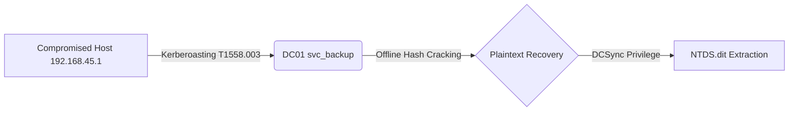

# Markdown Report Styler (`md-style`)

> A modular, publication-grade document generation toolkit for transforming Markdown into professional **Digital Forensics & DFIR Incident Reports, Civic & HOA (SVJ) Assembly Notices, Academic Reports, and Executive Memos** using Pandoc, Python, and modern web standards.

---

## Key Highlights

- **4-Stage Modular Pipeline**:
  - **Stage 1**: Pre-processing & Diagram Rendering (static SVG generation via `beautiful-mermaid`).
  - **Stage 2**: Security Indicator Discovery & Intelligence Gathering (MITRE, Windows Event Logs, CVE, GHSA, Network IPs, Custom Knowledge).
  - **Stage 3**: Pure Pandoc AST Compilation with hierarchical Lua filters and semantic HTML.
  - **Stage 4**: Post-Assembly, standalone HTML packaging (`--embed-resources`), and headless PDF compilation.
- **Interactive Cyber Intelligence (`forensic/cyber`)**:
  - **Slide-Over Knowledge Drawer**: Click on any detected indicator to inspect tactical threat intelligence, investigation tips, attacker behavior, and benign causes.
  - **Automatic Pill Tagging**: Recognizes MITRE ATT&CK techniques, CVEs, GHSAs, Windows Event IDs, EVTX logs, SHA256/MD5 hashes, and IP addresses across code backticks and plain text.
  - **OPSEC Confidentiality Safeguards**: Automatically suppresses external reputation queries (AbuseIPDB, VirusTotal) for RFC 1918 private intranet endpoints.
  - **HUD Controls**: Two-tier sticky breadcrumbs, Reading Progress bar, Theme Switcher (Cyber Dark vs. Lab Light), and Section Mode reading view.
- **Custom Case Knowledge Bases (YAML / JSON)**:
  - Provide a folder of YAML files (e.g. `./knowledge/` or `-k / --knowledge <dir>`) defining case-specific accounts, domain controllers, staging tools, or incident aliases.
  - Punctuation-aware prose and code matching transforms custom entities into interactive pills (`.custom-pill`) with custom drawer metadata.
- **Layered Cascading Localization (i18n)**:
  - Three-tier catalog hierarchy: `core/i18n/` (base document terms) $\to$ `styles/i18n/` (domain terminology) $\to$ document frontmatter overrides.
  - Polyglot sharing: Babel CLDR normalization, Pandoc `--metadata` integration, CSS variables (`:root { --i18n-... }`), and embedded browser JSON (`#report-i18n`).
- **Dual Layout Engines**:
  - **Native Print (`--print`)**: Zero-JS W3C `@media print` engine. Fast (<3s), compact, pixel-perfect for physical paper and PDF export.
  - **Paged.js Polyfill (`--paged`)**: Simulates real A4 paper sheets with drop shadows, page numbers, and running headers/footers in the browser.
- **Fully Self-Contained Output**:
  - Inlines stylesheets, fonts, SVG diagrams, and intelligence data into a single portable `.html` file with zero external runtime dependencies.

---

## Available Themes & Hierarchical Styles

`md-style` organizes styles into logical families with backwards-compatible aliases:

```
styles/
├── forensic/
│   ├── cyber.css (alias: forensic-cyber)   # Cyber DFIR HUD, IoC drawer, dark/light themes
│   └── dossier.css (alias: forensic)       # Formal evidence dossier & court report layout
├── svj/
│   ├── modern.css (alias: svj-modern)      # Contemporary HOA meeting notice
│   ├── ballot.css (alias: svj-ballot)      # Voting ballot resolution sheets
│   ├── community.css                       # High-contrast accessible layout for seniors
│   ├── invitation.css                      # Traditional serif assembly notice
│   └── typewriter.css                     # Retro Czechoslovak typewriter aesthetic
├── school.css                              # Academic syllabus & progress assessment
└── announcement.css                        # Corporate executive memorandum
```

| Theme | CLI Flag | Frontmatter | Purpose & Visual Identity |
|---|---|---|---|
| **Forensic Cyber** | `-s forensic/cyber` | `style: forensic/cyber` | Cyber threat investigation HUD, interactive slide-over knowledge drawer, MITRE ATT&CK pills, dark/light toggle. |
| **Forensic Dossier** | `-s forensic/dossier` | `style: forensic` | Classic digital forensics report, evidence custody chain, TLP status badges, terminal code blocks. |
| **SVJ Modern** | `-s svj/modern` | `style: svj-modern` | Building assembly notice: key info card grid (Date, Time, Place), agenda timeline, proposal callouts. |
| **SVJ Ballot** | `-s svj/ballot` | `style: svj-ballot` | Extends `svj-modern` with printable voting resolution ballot boxes (`☐ PRO`, `☐ PROTI`, `☐ ZDRŽEL SE`). |
| **SVJ Community** | `-s svj/community` | `style: svj-community` | WCAG AAA contrast, relaxed line height, large meeting cards, designed for elderly residents. |
| **SVJ Typewriter** | `-s svj/typewriter` | `style: svj-typewriter` | Mechanical typewriter aesthetic (Consul typeface, red-ribbon motion callouts, typed table grids). |
| **SVJ Classic** | `-s svj/invitation` | `style: svj-invitation` | Traditional serif assembly invitation notice (*Pozvánka na shromáždění SVJ*). |
| **School Report** | `-s school` | `style: school` | Academic progress assessments, course rubrics, student dossier grids, booktabs tables. |
| **Announcement** | `-s announcement` | `style: announcement` | Executive memorandums, `TO/FROM/DATE/SUBJECT` header block, urgency banners, action task checklists. |

---

## Requirements & Installation

### Prerequisites
- **[Pandoc](https://pandoc.org/)** (v2.19+ or v3.x)
- **[uv](https://github.com/astral-sh/uv)** (recommended Python toolchain runner) or Python 3.9+ with `pyproject.toml` dependencies
- Optional: `chromium-browser` or `google-chrome` for headless PDF generation (`-p` / `--pdf`)

### Running via `uv` or POSIX Wrapper
The repository includes a POSIX runner script `md-to-report.sh` that delegates directly to `uv run md-to-report`:

```bash
# Clone the repository
git clone https://github.com/valor-x/md-style.git
cd md-style

# Direct execution via runner script:
./md-to-report.sh --help

# Or run natively with uv:
uv run md-to-report --help
```

---

## Quick Start

### 1. Generate an Interactive Cyber DFIR Report
```bash
./md-to-report.sh investigation.md -s forensic/cyber -o report.html
```

### 2. Include Custom Case Knowledge (Accounts, Hostnames, IOCs)
```bash
./md-to-report.sh investigation.md -s forensic/cyber -k ./case-knowledge -o report.html
```

### 3. Generate a Building Assembly Ballot
```bash
./md-to-report.sh pozvanka-shromazdeni.md -s svj/ballot --print -o pozvanka.html
```

### 4. Compile Directly to PDF
```bash
./md-to-report.sh pozvanka-shromazdeni.md -s svj/modern --print -p -o pozvanka.pdf
```

---

## Command-Line Options (`md-to-report`)

```text
md-to-report [OPTIONS] <input.md> [output.html]
```

| Option | Description | Default |
|---|---|---|
| `-o, --output <file>` | Custom destination path (`.html` or `.pdf`) | `<input>.html` |
| `-s, --style <name>` | Theme (`forensic/cyber`, `forensic/dossier`, `svj/ballot`, etc.) | `forensic` |
| `-k, --knowledge <path>` | Path to custom knowledge directory or YAML/JSON file | Auto-detected (`./knowledge`) |
| `-t, --title <string>` | Override document title | Extracted from Markdown |
| `-l, --lang <code>` | Document language code (`cs`, `en`, `sk`, `de`) | `en` (or frontmatter) |
| `--print` | Native Print mode (zero-JS, deterministic `@media print`) | Disabled |
| `--paged` | Enable Paged.js pagination (simulated A4 sheets on screen) | Disabled |
| `--toc` / `--no-toc` | Toggle Table of Contents | Enabled (`--toc`) |
| `--toc-depth <1-6>` | Maximum heading depth shown in TOC | `3` |
| `-N, --number-sections` | Auto-number headings (`1.`, `1.1`, `1.2`) | Off |
| `--highlight-style <name>`| Syntax highlighting style (`kate`, `monochrome`, etc.) | `kate` |
| `--embed-resources` | Inlines styles/fonts/images into a standalone HTML file | Enabled |
| `--no-mermaid` | Disable Mermaid diagram rendering | Enabled |
| `--offline` | Disable on-demand online scraping for indicators | Online enabled |
| `--inspect` | Dry-run diagnostic scan (inspect enrichments and tokens) | Off |
| `--list-styles` | List all available built-in document themes | - |
| `-p, --pdf` | Compile directly to PDF via headless Chromium | Disabled |
| `--open` | Open generated report in default browser after build | Disabled |
| `-v, --verbose` | Verbose diagnostic logging | Disabled |
| `-q, --quiet` | Silence non-error messages | Disabled |

---

## Custom Case Knowledge Base (YAML / JSON)

To provide explanations and threat context for case-specific entities (service accounts, internal hostnames, IP subnets, or staging scripts), provide a folder of YAML files.

### 1. Directory Structure & Discovery
`md-style` automatically searches:
1. CLI flag: `-k / --knowledge <path>`
2. Frontmatter: `knowledge: ./case-intel`
3. Sibling folder: `./knowledge/` or `./kb/`
4. Parent case folder: `../knowledge/` (shared across reports in an incident folder)

```
case-2026-0920/
├── knowledge/
│   ├── accounts.yaml
│   ├── assets.yaml
│   └── tools.yaml
└── 0report/
    └── forenzni-analyza.md   # Automatically inherits ../knowledge/
```

### 2. Knowledge Entry Format (`knowledge/*.yaml`)
```yaml
# Example: knowledge/accounts.yaml
- id: "svc_backup"                     # Unique identifier
  match:
    exact:
      - "svc_backup"
      - "svc_backup@corp.internal"
    regex: '(?i)\bsvc_[a-z0-9_]+\b'     # Optional regex pattern
    in_code: true                      # Match within `code backticks`
    in_prose: true                     # Match within plain text prose
    case_sensitive: false

  badge: "SERVICE ACCOUNT"             # Drawer badge label
  badge_type: "account"                # Visual theme: account, host, critical, warning, custom
  category: "ACTIVE DIRECTORY // PRIVILEGED"
  role: "Service Account"
  title: "AD Backup Service Account"
  summary: "Domain-level backup account with SeBackupPrivilege. Compromised via Kerberoasting."

  fields:                              # Arbitrary key-value metadata rows
    "DOMAIN": "corp.internal"
    "PRIVILEGES": "Domain Admins, SeBackupPrivilege"
    "STATUS": "Compromised // Kerberos Ticket 0x17 Requested"
    "INCIDENT ROLE": "Primary Kerberoasting Target (T1558.003)"

  investigation_tips:                  # Forensic guidance checklist
    - "Check Event ID 4769 in Security.evtx filtered by ServiceName 'svc_backup'."
    - "Verify Kerberos Ticket Encryption Type is 0x17 (RC4-HMAC)."

  attacker_behavior:                   # Threat actor activity notes
    - "Attacker used Rubeus to request a service ticket for offline cracking."

  benign_causes:                       # Benign causes block
    - "Scheduled backup job running Veeam tape synchronization."

  pivots:                              # Custom reference links
    - label: "ACTIVE DIRECTORY AUDIT DOCS ↗"
      url: "https://learn.microsoft.com/en-us/windows-server/identity/ad-ds/plan/security-best-practices/monitoring-active-directory-for-signs-of-compromise"
```

### 3. Compact Syntax
For quick definitions, compact single-string syntax is also supported:
```yaml
- match: "DC01.corp.internal"
  badge: "PRIMARY DOMAIN CONTROLLER"
  badge_type: "host"
  summary: "Primary Domain Controller running Windows Server 2022 at 192.168.45.2."
  fields:
    "HOST IP": "192.168.45.2"
    "ROLES": "AD DS, DNS, Kerberos KDC"
```

---

## Interactive Cyber Telemetry & Indicator Intelligence

When using `-s forensic/cyber`, `md-style` enriches security telemetry:

- **Windows Event IDs (`EID 5001`, `Event ID 4624`)**:
  - Automatically queries the local event database and persistent cache.
  - Guarantees uniform prefix retention across compound lists:
    `Event ID 4624, 4625 and 4672` $\to$ `<code class="eventid-pill">Event ID 4624</code>`, `<code class="eventid-pill">Event ID 4625</code>`, `<code class="eventid-pill">Event ID 4672</code>` (no bare numbers).
  - Inspects channel, audit categories, investigation tips, and pivots to Ultimate Windows Security and Microsoft Docs.
- **Windows EVTX Channels (`Security.evtx`, `Defender.evtx`)**:
  - Identifies log channels, default filesystem paths, and key event associations.
- **MITRE ATT&CK (`T1558.003`, `T1059.001`)**:
  - Identifies tactics, platforms, description, and direct links to ATT&CK Framework.
- **Vulnerabilities (`CVE-2024-21413`, `GHSA-...`)**:
  - Displays CVSS severity badges, affected software components, and links to NIST NVD and GitHub Advisory Database.
- **Network IP Addresses**:
  - **RFC 1918 Private IPs (`10.x`, `192.168.x`, `172.16-31.x`, `127.x`)**: Tagged as `INTERNAL RFC 1918`. Outbound lookups to external reputation services are strictly suppressed to preserve client OPSEC.
  - **Public WAN IPs**: Tagged as `PUBLIC WAN IP` with verified pivots to AbuseIPDB and VirusTotal.
- **Cryptographic Hashes (SHA256, SHA1, MD5)**:
  - Formatted with character length badges and VirusTotal hash search pivots.

---

## Markdown Formatting Guide

### 1. YAML Frontmatter
```yaml
---
title: "Forenzní analýza kybernetického incidentu"
subtitle: "Incident IR-2026-0920: EnterpriseCorp Active Directory"
author: "Forenzní analytik"
date: "2026-09-21"
lang: cs
classification: "DŮVĚRNÉ // FORENZNÍ ŠETŘENÍ"
style: forensic/cyber
knowledge: "./knowledge"
toc: true
toc-depth: 3
---
```

### 2. Localization & Layered i18n
Supported out of the box: `en` (English), `cs` (Czech), `sk` (Slovak), `de` (German).
All standard headings (`Obsah`, `Datum`, `Vyšetřovatel`, `Oficiální zpráva`, `Důvěrné`) adapt automatically based on the document language.

### 3. Timeline Tables with Unwrapped Timestamps
Table timestamps and hash registers are automatically kept on a single line (`filters/forensic-cyber.lua` / `styles/forensic-cyber.lua`):

```markdown
| Položka | Časová značka (UTC) | Hostitel | Zjištěná aktivita |
|---|---|---|---|
| `LOG-01` | `2026-09-20 02:14:22` | `DC01` | Útočník vypíná ochranu Microsoft Defender (`EID 5001`) |
| `LOG-02` | `2026-09-20 02:15:05` | `192.168.45.1` | Pokus o Kerberoasting servisního účtu `svc_backup` |
```

### 4. Mermaid Diagrams
Fenced Mermaid code blocks are rendered into static, dark-mode/light-mode compatible SVGs at build time without requiring client-side JavaScript:

````markdown

````

### 5. Inlined Table of Contents (SVJ & Assemblies)
For agenda documents where the TOC belongs inside the body text:

```markdown
## Program shromáždění

::: {#toc}
:::
```

Also supports `[TOC]`, `[[_TOC_]]`, and `<!-- TOC -->`.

---

## Technical Documentation

Detailed architecture manuals, threat intelligence specifications, layout guides, and localization references are available in the [`docs/`](docs/index.md) directory:

- 📖 **[Documentation Hub](docs/index.md)**: Master index and role-based reading guide.
- ⚙️ **[System Architecture](docs/architecture.md)**: Deep dive into the 4-stage pipeline, `uv` CLI integration, and Pandoc multi-pass AST filters.
- 🛡️ **[Threat Intelligence & Knowledge Base](docs/knowledge-base.md)**: Specifications for Windows Event IDs, EVTX logs, CVE/GHSA/MITRE, network OPSEC, and custom YAML case intelligence.
- 🎨 **[Style & Layout Development](docs/style-development.md)**: Theme creation guide, design tokens, Paged.js Firefox multi-column fixes, and automated headless verification.
- 🌐 **[Localization & Internationalization](docs/localization.md)**: The 3-tier cascading i18n framework, CLDR language normalization, and polyglot delivery.

---

## License & Attribution

Distributed under the Apache 2.0 License. Developed for digital forensics practitioners, incident responders, building associations, and technical authors requiring uncompromising document quality.

