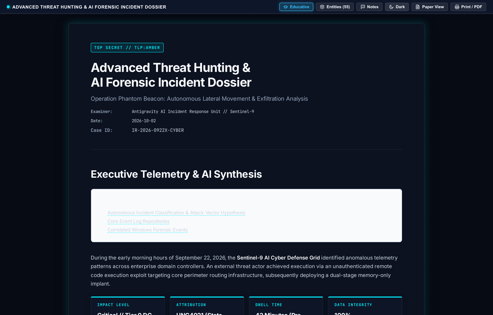
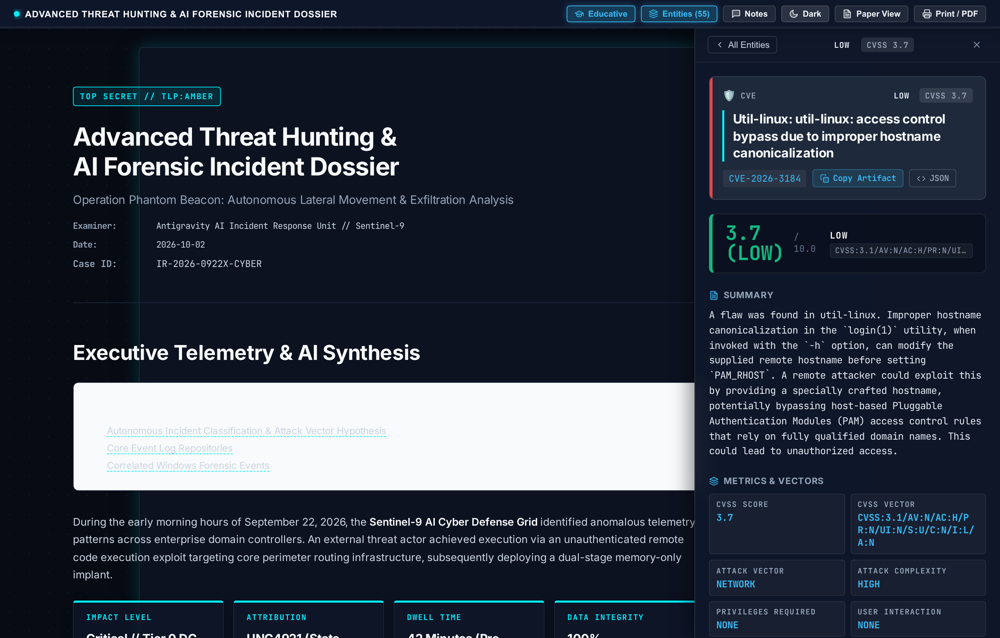
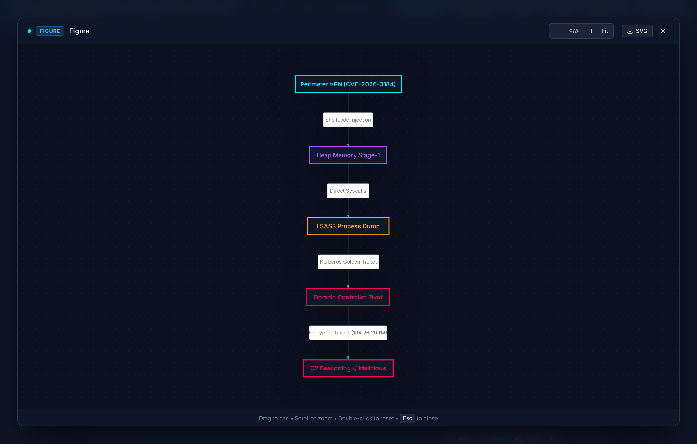
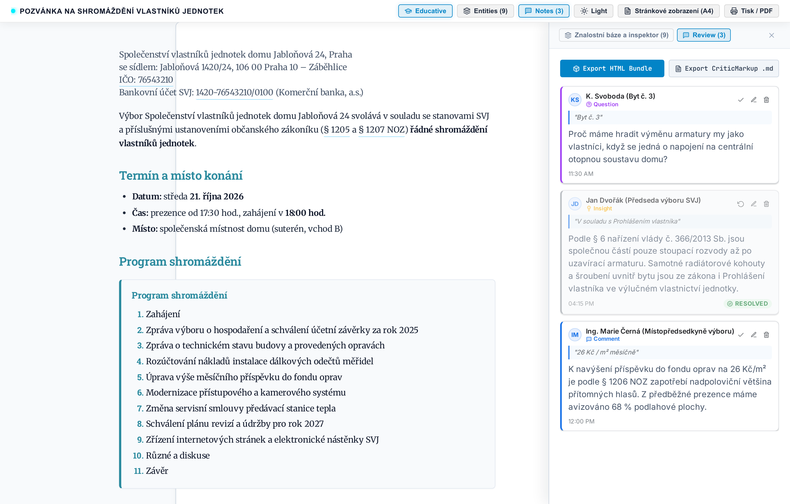
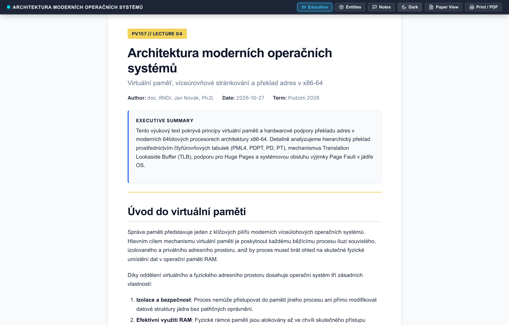
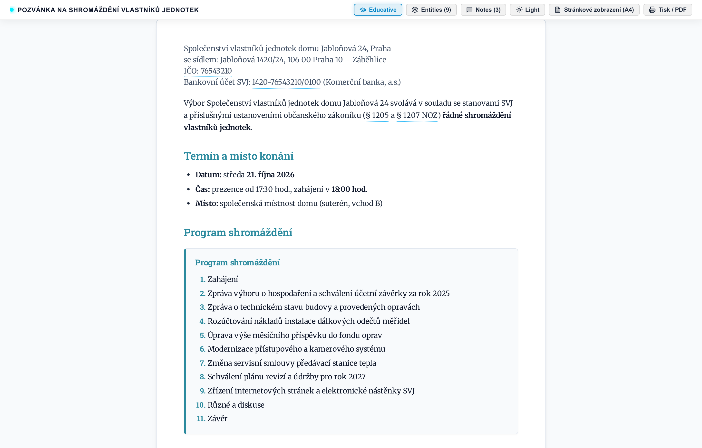
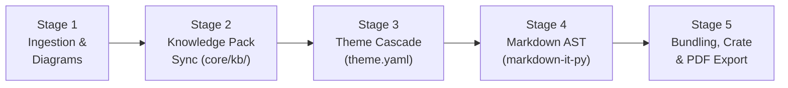

# Markdown Report Styler (`md-style` v3.0)

[](LICENSE)
[](https://www.python.org/downloads/)
[](docs/architecture.md)
[](https://www.researchobject.org/ro-crate/)
[](viewer/)

> A **pure-Python, publication-grade document generation and knowledge packaging toolkit**. Compiles Markdown into **self-contained interactive HTML reports**, **pixel-perfect W3C print PDFs**, and **compliant RO-Crate 1.1 digital evidence packages** with zero Pandoc dependency.

---

## 📸 Visual Showcase

| Interactive Cyber DFIR Report | Slide-Over Threat Intelligence Drawer |
| :---: | :---: |
|  |  |
| *Cyber threat investigation HUD with dark/light theme, indicator pills, and reading progress.* | *Click any entity pill to reveal tactical guidance, benign causes, and MITRE/CVE context.* |

| Pan & Zoom Vector Figure Lightbox | Collaborative Margin Review Comments |
| :---: | :---: |
|  |  |
| *Zoomable, draggable vector lightbox for Mermaid and D2 architecture diagrams with theme inheritance.* | *Google Docs-style inline text annotations with threaded comments and status flags.* |

| Academic Lecture & Research Notes | Civic Assembly Notice & Ballot |
| :---: | :---: |
|  |  |
| *Multi-column academic layouts, booktabs tables, callout blocks, and formula support.* | *Formal condominium / HOA meeting notices with agenda cards and printable voting ballots.* |

---

## ⚡ Key Highlights & Core Invariants

- 🐍 **Zero Pandoc Dependency (Pure Python v3)**:
  - Document parsing, transformation, and AST compilation run entirely on Python (`markdown-it-py` with custom pure-Python plugins in `core/parser/`). No external binary document processors required.
- 🛡️ **100% Offline Air-Gap Safe**:
  - All indicator resolvers (`core/kb/resolvers/`) operate securely in air-gapped environments using local Single Source of Truth catalogs (`data/statutes.json`, `data/cve.json`, etc.).
  - **OPSEC Confidentiality Safeguards**: RFC 1918 private subnets (`10.0.0.0/8`, `172.16.0.0/12`, `192.168.0.0/16`, `127.0.0.0/8`) strictly suppress external reputation lookups.
- 📦 **Single-File Self-Contained Output**:
  - The bundled `.html` inlines all stylesheets, base64 WOFF2 fonts (`core/fonts.py`), sanitized SVG diagrams, and JSON metadata into a single portable file that renders offline with `file://`.
- 🔍 **Source Reversible**:
  - Bundled HTML reports contain the raw Markdown source and Knowledge Pack metadata inside embedded script blocks. You can preview, de-bundle, or inspect them directly with `md-style preview` or `md-style inspect`.
- 🗃️ **RO-Crate 1.1 Research Object Packaging**:
  - Export self-contained `.crate.zip` archives with full JSON-LD schema metadata and cryptographic SHA-256 evidence digests for legal custody and reproducible forensic audits.
- 🖨️ **Pixel-Perfect W3C Paged Media & PDF**:
  - Native `@media print` rules, running headers/footers, and page numbers via headless Chromium or Bun CDP bridge (`--pdf`).

---

## 🚀 Quick Start

### Installation

`md-style` requires **Python 3.9+**. We recommend using [`uv`](https://github.com/astral-sh/uv) for fast, isolated execution:

```bash
# Clone the repository
git clone https://github.com/valor-x/md-style.git
cd md-style

# Inspect CLI capabilities
uv run md-style --help
```

### 1. Compile an Interactive Cyber DFIR Report

```bash
uv run md-style examples/sample-forensic-cyber.md -s forensic/cyber -o investigation.html
```

### 2. Compile Directly to Pixel-Perfect PDF

```bash
uv run md-style examples/sample-forensic-cyber.md -s forensic/cyber --pdf -o investigation.pdf
```

### 3. Package as an RO-Crate 1.1 Archive with Digital Evidence

```bash
uv run md-style examples/sample-forensic-cyber.md -s forensic/cyber \
  --crate --evidence ./evidence/ -o case-investigation.crate.zip
```

### 4. Verify an RO-Crate Archive

```bash
uv run md-style --verify-crate case-investigation.crate.zip
```

### 5. Terminal Markdown & Knowledge Pack Previews

```bash
# Preview Markdown directly in your terminal:
uv run md-style preview investigation.html

# Inspect all discovered intelligence indicators in the terminal:
uv run md-style inspect investigation.html
uv run md-style inspect investigation.html CVE-2024-3094
```

---

## 🎨 Theme Suite & Hierarchy

`md-style` uses declarative cascading theme inheritance (`styles/**/theme.yaml`). Themes define typography tokens, color palettes, W3C Paged geometry, and viewer feature flags:

```text
styles/
├── base/                     # Universal root theme (typography, print reset)
├── forensic/
│   ├── cyber/                # Interactive DFIR HUD, IoC drawer, light/dark switch
│   └── dossier/              # Formal evidence dossier, legal chain of custody
├── academic/
│   ├── lecture/              # University lecture notes, textbook layout
│   ├── classic/              # Traditional academic paper format
│   ├── modern/               # Clean contemporary technical paper
│   └── handbook/             # Reference manual and technical handbook
├── svj/
│   ├── base/                 # Civic & HOA meeting notice base
│   ├── invitation/           # Traditional assembly notice (Pozvánka na shromáždění)
│   └── ballot/               # Extends invitation with printable voting ballot boxes
└── general/
    ├── announcement/         # Executive memorandum and urgency notice
    ├── school/               # Course rubrics and student evaluations
    └── family-invite/        # Formal invitations and event schedules
```

### Theme CLI Tools

```bash
# List all discovered themes and page formats:
uv run md-style theme list

# Deep-dive inspection of a theme's cascade, variables, and Paged geometry:
uv run md-style theme inspect forensic/cyber

# Static audit and linting across all themes or a specific style:
uv run md-style theme lint

# Scaffold a new custom theme:
uv run md-style theme new custom/corporate --extends base
```

---

## 🧠 Threat Intelligence & Indicator Engine

When compiling documents, `md-style` automatically recognizes indicators across prose and `code backticks`:

- **CVEs & GHSAs** (`CVE-2024-3094`, `GHSA-...`): Severity badges, affected components, and direct pivots to NIST NVD.
- **MITRE ATT&CK** (`T1558.003`, `T1059.001`): Tactics, execution platforms, and links to MITRE Enterprise matrix.
- **Windows Event IDs & EVTX Channels** (`Event ID 4624`, `Security.evtx`): Channel classification, audit tips, and prefix normalization.
- **Network IPs**:
  - Private RFC 1918 addresses (`10.x`, `192.168.x`, `172.16-31.x`): Strictly labeled as `INTERNAL RFC 1918` with external lookups suppressed for client OPSEC.
  - Public IPs: Formatted with verified pivots to AbuseIPDB and VirusTotal.
- **Cryptographic Hashes**: SHA-256, SHA-1, and MD5 hashes with VirusTotal pivots.
- **Civic & Legal Identifiers**: Czech Statutes (`§ 1180 NOZ`), Business IDs (`IČO`), and International Bank Account Numbers (`IBAN`).

### Custom Case Knowledge Base (YAML / JSON)

You can supply case-specific intelligence (internal hostnames, staging tools, compromised accounts) via `-k / --knowledge <dir>` or a `./knowledge/` directory:

```yaml
# knowledge/accounts.yaml
- id: "svc_backup"
  match:
    exact:
      - "svc_backup"
      - "svc_backup@corp.internal"
    regex: '(?i)\bsvc_[a-z0-9_]+\b'
    in_code: true
    in_prose: true
  badge: "SERVICE ACCOUNT"
  badge_type: "account"
  category: "ACTIVE DIRECTORY // PRIVILEGED"
  title: "AD Backup Service Account"
  summary: "Domain backup account with SeBackupPrivilege. Primary Kerberoasting target."
  fields:
    "DOMAIN": "corp.internal"
    "PRIVILEGES": "Domain Admins, SeBackupPrivilege"
    "STATUS": "Compromised // Kerberos Ticket 0x17 Requested"
  investigation_tips:
    - "Check Event ID 4769 in Security.evtx filtered by ServiceName 'svc_backup'."
    - "Verify Kerberos Ticket Encryption Type is 0x17 (RC4-HMAC)."
```

---

## 🛠️ CLI Reference

```text
md-style [OPTIONS] <input.md> [output.html]
```

| Option | Description | Default |
|---|---|---|
| `-s, --style <name>` | Theme (`forensic/cyber`, `svj/ballot`, `academic/lecture`, etc.) | Frontmatter or `forensic` |
| `-o, --output <file>` | Custom destination file (`.html`, `.pdf`, `.crate.zip`) | `<input>.html` |
| `-p, --pdf` | Compile directly to PDF via Chromium CDP bridge | Disabled |
| `--crate` | Package as RO-Crate 1.1 archive (`.crate.zip`) | Disabled |
| `--evidence <path>` | Directory or file of digital evidence to bundle into RO-Crate | `None` |
| `--verify-crate <zip>`| Verify SHA-256 integrity and metadata of an RO-Crate archive | - |
| `-k, --knowledge <dir>`| Path to custom knowledge directory or YAML/JSON file | `./knowledge` (auto) |
| `--offline` | Air-gapped mode: disable all dynamic online lookups | Enabled by default |
| `--kb-refresh [mode]` | Refresh Knowledge Pack (`incremental`, `sources`, `force`) | `incremental` |
| `--inspect [token]` | Inspect Knowledge Pack indicators in terminal or drill down | - |
| `--preview` | Render document directly in the terminal | - |
| `--theme-inspect [name]`| Deep-dive cascade inspection of a theme | - |
| `--theme-lint [target]` | Static audit and linting of themes and stylesheets | - |
| `--theme-new <name>` | Scaffold a new starter theme | - |
| `--toc` / `--no-toc` | Toggle automatic Table of Contents | Enabled (`--toc`) |
| `-l, --lang <code>` | Document language code (`en`, `cs`, `sk`, `de`) | Frontmatter or `en` |
| `--no-viewer` | Compile pure static HTML without interactive Svelte HUD | Interactive HUD |
| `-v, --verbose` | Enable verbose diagnostic logging | Disabled |

---

## 🏗️ Architecture & Pipeline

`md-style` compiles documents through a modular 5-stage pipeline ([`core/pipeline/`](core/pipeline/)):



1. **Stage 1 (Ingestion & Diagrams)**: Normalizes nested containers, parses frontmatter, renders Mermaid/D2 diagrams to vector SVGs, and assigns unified figure numbers.
2. **Stage 2 (Knowledge Pack Sync)**: Discovers indicators in prose/code, resolves context against SSOT catalogs, and computes SHA-256 integrity digests.
3. **Stage 3 (Theme Resolution)**: Resolves declarative inheritance (`theme.yaml`), merges CSS tokens, and extracts Paged.js page geometry.
4. **Stage 4 (Markdown AST)**: Compiles Markdown tokens via `markdown-it-py`, wrapping indicators in interactive pills, callout alerts, and responsive data tables.
5. **Stage 5 (Bundling & Export)**: Inlines base64 WOFF2 fonts and stylesheets, injects the Svelte 5 interactive viewer bundle, creates RO-Crate archives, or generates PDFs.

---

## 🧪 Testing & Verification

Run the comprehensive Pytest test suite:

```bash
# Run unit and integration tests:
uv run pytest tests/test_theme_tools.py tests/test_themes.py tests/test_inspector_cli.py tests/test_engine_diagnostics.py -v

# Run Knowledge Base lifecycle & resolver tests:
uv run pytest tests/test_kb_lifecycle.py tests/test_kb_resolvers.py tests/test_ro_crate.py -v

# Run full test suite:
uv run pytest tests/
```

Audit theme configurations:
```bash
uv run md-style theme lint
```

---

## 📚 Technical Documentation

Comprehensive architecture manuals, layout guides, and specifications are located in [`docs/`](docs/index.md):

- 📖 **[Documentation Hub](docs/index.md)**: Master index and role-based reading guide.
- ⚙️ **[System Architecture](docs/architecture.md)**: Modular 5-stage pipeline, AST compilation, and Svelte 5 viewer integration.
- 🛡️ **[Threat Intelligence & Knowledge Base](docs/knowledge-base.md)**: Windows Event IDs, EVTX logs, CVE/GHSA, network OPSEC, and custom YAML schemas.
- 🎨 **[Style & Layout Development](docs/style-development.md)**: Theme inheritance, design tokens, W3C Paged media, and print layouts.
- 🌐 **[Localization & Internationalization](docs/localization.md)**: 3-tier cascading i18n framework, CLDR normalization, and multilingual support.

---

## 📄 License & Attribution

Distributed under the **Apache 2.0 License**. See [LICENSE](LICENSE) for details. Built for digital forensics practitioners, incident response teams, condominium boards, and technical authors requiring uncompromising document quality.
