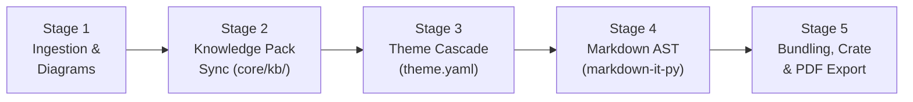

# System Architecture — `md-style` v3.0

The `md-style` toolchain is a pure-Python, publication-grade document generation and knowledge packaging system. It compiles standard Markdown source documents into:
1. **Self-Contained Interactive HTML Reports** with reactive Svelte 5 overlays, slide-over knowledge inspector drawers, inline indicator pills, figure lightboxes, and collaborative margin review comments.
2. **Pixel-Perfect PDF Documents** adhering to W3C `@media print` and Paged.js page geometry specifications via Chromium headless printing or Bun CDP bridge.
3. **Standard RO-Crate Research Object Packages (`.crate.zip`)** compliant with RO-Crate v1.1 and JSON-LD schema metadata for reproducible forensic audits.

---

## 1. Fundamental Architectural Invariants

1. **Zero Pandoc Dependency (Pure Python v3)**:
   * The pipeline does **NOT** invoke `pandoc` or external binary document compilers.
   * Markdown AST parsing is handled by `markdown-it-py` with custom pure-Python plugins (`core/parser/`).
   * Templating is powered by Jinja2 and Rich.
2. **100% Offline Air-Gap Safety**:
   * All entity resolvers (`core/kb/resolvers/`) function safely in an offline air-gapped environment using local Single Source of Truth (SSOT) databases (`data/statutes.json`, `data/cve.json`, etc.) and local caches.
   * Any dynamic web scraping (e.g. *Zákony pro lidi*, NVD, AbuseIPDB) is strictly gated behind `allow_online: bool = False` or `--offline`.
3. **Single-File Self-Contained Output**:
   * The bundled `.html` is 100% standalone and portable.
   * All fonts (`core/fonts.py`), CSS stylesheets, SVG diagrams, and JSON metadata are inlined into the HTML. Opening the file with `file://` in any browser with networking disabled renders flawlessly.
4. **Source Reversibility**:
   * Bundled HTML reports contain the original Markdown source inside `<script type="text/markdown" id="md-style-source-markdown">` and the Knowledge Pack inside `<script type="application/json" id="md-style-kb-data">`.
   * CLI tools (`md-style preview`, `md-style inspect`) can de-bundle and preview HTML files directly.

---

## 2. High-Level Pipeline Architecture

The document compiler runs a sequential 5-stage pipeline managed by [`core/pipeline/`](file:///home/valor/Devel/personal/md-style/core/pipeline/):



### Stage 1: Ingestion & Diagram Rendering
* **Objective**: Input normalization, YAML frontmatter validation, locale resolution, and static vector diagram compilation.
* **Component**: [`core/pipeline/stages/ingestion.py`](file:///home/valor/Devel/personal/md-style/core/pipeline/stages/ingestion.py)
* **Actions**:
  * Normalizes nested container blocks (e.g. `::: {.kpi-grid}`, `> [!NOTE]`).
  * Parses frontmatter (`core/frontmatter.py`) and resolves document language (`cs`, `en`, `sk`, `de`).
  * Renders Mermaid diagrams to optimized vector SVGs via `beautiful-mermaid` and D2 diagrams via `d2` CLI.
  * Assigns unified sequential figure numbers across all diagram types (`FigureManager`).

### Stage 2: Knowledge Pack Synchronization
* **Objective**: Discover indicators, resolve forensic and legal context, and synchronize case metadata.
* **Component**: [`core/pipeline/stages/knowledge.py`](file:///home/valor/Devel/personal/md-style/core/pipeline/stages/knowledge.py)
* **Actions**:
  * Scans prose and code tokens for security indicators (CVEs, CWEs, MITRE ATT&CK, Windows Event IDs, EVTX channels, hashes, IPv4/IPv6 addresses) and civic indicators (Statutes, IČO, IBAN).
  * Enriches indicators against offline SSOT catalogs (`data/`) or local caches.
  * Ingests case-specific custom knowledge from `./knowledge/` or `-k / --knowledge`.
  * Computes SHA-256 integrity digests for all resolved knowledge entities.

### Stage 3: Theme Resolution & Cascade
* **Objective**: Resolve declarative theme inheritance, typography tokens, and Paged.js page geometry.
* **Component**: [`core/pipeline/stages/theme.py`](file:///home/valor/Devel/personal/md-style/core/pipeline/stages/theme.py)
* **Actions**:
  * Resolves inheritance chain from `base` down to the leaf theme (`styles/**/theme.yaml`).
  * Merges CSS custom properties (`--color-accent`, `--font-sans`, `--doc-max-width`).
  * Extracts Paged.js margins, paper sizes (A4, Letter), and running header/footer rules.
  * Configures feature flags (`interactive_viewer`, `callouts`, `sticky_tables`).

### Stage 4: Markdown AST Compilation
* **Objective**: Transform Markdown tokens into semantic, accessible HTML markup.
* **Component**: [`core/pipeline/stages/compilation.py`](file:///home/valor/Devel/personal/md-style/core/pipeline/stages/compilation.py)
* **Actions**:
  * Compiles Markdown via `markdown-it-py` plugins (`core/parser/plugins/`).
  * Wraps indicators in interactive pill tags (`<span class="inspectable" data-entity-id="...">`).
  * Formats GitHub-style alert callouts (`> [!NOTE]`, `> [!WARNING]`).
  * Wraps responsive data tables with search and column sorting controls.
  * Synthesizes automated Tables of Contents and dossier header blocks.

### Stage 5: Bundling, RO-Crate Packaging & PDF Export
* **Objective**: Package the deliverable as a standalone HTML file, RO-Crate 1.1 archive, or vector PDF.
* **Component**: [`core/pipeline/stages/export.py`](file:///home/valor/Devel/personal/md-style/core/pipeline/stages/export.py)
* **Actions**:
  * **HTML Bundling**: [`core/bundler/`](file:///home/valor/Devel/personal/md-style/core/bundler/) inlines all CSS stylesheets, base64 WOFF2 fonts (`core/fonts.py`), and sanitized vector SVGs (`core/svg/processor.py`).
  * Injects Svelte 5 interactive viewer bundle (`core/assets/viewer.bundle.js`).
  * Embeds raw source Markdown and Knowledge Pack JSON scripts for source reversibility.
  * **RO-Crate Packaging**: Generates compliant RO-Crate 1.1 `.crate.zip` with `ro-crate-metadata.json` and digital evidence files.
  * **PDF Export**: Generates vector print PDFs matching W3C `@media print` via Chromium CDP bridge (`viewer/scripts/print-pdf.mjs`).

---

## 3. Directory Layout & Module Responsibilities

```text
md-style/
├── core/                         # Core Python toolchain
│   ├── assets/                   # Pre-compiled viewer bundle (JS & CSS)
│   ├── bundler/                  # AssetResolver, HtmlDocumentBuilder, CdpTemplateBuilder
│   ├── cli.py                    # Main CLI entrypoint (build_parser, routing)
│   ├── config.py                 # System paths, cache defaults, environment config
│   ├── crate.py                  # RO-Crate 1.1 packaging and cryptographic verification
│   ├── diagnostics.py            # Rich terminal tables, logging, pipeline timers
│   ├── diagrams/                 # Mermaid and D2 diagram rendering bridges
│   ├── fonts.py                  # Offline font cache and WOFF2 base64 inliner
│   ├── i18n/                     # Layered catalog localization engine
│   ├── kb/                       # Knowledge Pack lifecycle, models, and indicator resolvers
│   ├── parser/                   # Pure-Python Markdown parser (markdown-it-py plugins)
│   ├── pipeline/                 # 5-stage ReportEngine and PipelineBuilder
│   │   ├── stages/               # Ingestion, Knowledge, Theme, Compilation, Export
│   │   ├── context.py            # PipelineConfig and PipelineContext
│   │   └── reporter.py           # Rich compilation summary cards
│   ├── svg/                      # SVGProcessor (sanitization, namespacing, CSS scoping)
│   ├── theme_tools/              # ThemeLinter, ThemeInspector, ThemeScaffolder
│   └── themes.py                 # Cascading ThemeResolver
├── data/                         # Offline SSOT catalogs (statutes, CVE, CWE, MITRE, EVTX)
├── styles/                       # Declarative theme suites (theme.yaml + CSS)
│   ├── base/                     # Universal root theme (fonts, paged base, reset)
│   ├── academic/                 # University teaching, lectures, handbook (FI MUNI)
│   ├── forensic/                 # DFIR investigation styles (cyber, dossier)
│   ├── svj/                      # Condominium / HOA styles (base, invitation, ballot)
│   └── general/                  # Announcement, school, family-invite
├── viewer/                       # Svelte 5 interactive viewer application
│   ├── src/
│   │   ├── annotations/          # Collaborative comments, DOM anchors, CriticMarkup export
│   │   ├── components/           # FigureToolbar, FigureLightbox, Icon widgets
│   │   ├── drawer/               # Slide-over InspectorDrawer modular sub-components
│   │   ├── inspector/            # Domain cards (CVE, WinEvent, EVTX, IP, Statute)
│   │   ├── App.svelte            # Root viewer client
│   │   └── HudRibbon.svelte      # Sticky HUD ribbon with progress & mode switcher
│   └── package.json              # Bundled via Vite / Bun
└── tests/                        # 260+ Pytest tests (unit, offline, print, e2e)
```

---

## 4. Interactive Viewer Architecture (Svelte 5)

The interactive viewer client is inlined into bundled HTML reports and mounts cleanly to `#md-style-viewer-root`:

1. **HUD Ribbon (`HudRibbon.svelte`)**:
   * Sticky top bar showing reading progress, active document section, Dark/Light mode toggle, and Reader vs. Educative mode.
2. **Knowledge Inspector Drawer (`viewer/src/drawer/`)**:
   * Slide-over drawer opening when clicking any `.inspectable` indicator pill or HUD button.
   * Search and category filter pills (`EntitySearchFilter.svelte`).
   * Rich entity cards with CVSS v3.1 gauges, MITRE technique tactics, ARES company data, SPAYD QR payment codes, and offline legal statute text.
3. **Figure Lightbox Modal (`FigureLightbox.svelte`)**:
   * Interactive modal with zoom & pan, high-res SVG export, and full-screen view for all Mermaid, D2, and inlined SVGs.
4. **Collaborative Margin Comments (`viewer/src/annotations/`)**:
   * Google Docs-style text selection popover to add comments and review notes.
   * Auto-anchored to text nodes with surrounding prefix/suffix context for resilient re-hydration.
   * Export to updated standalone HTML bundle or source Markdown with CriticMarkup notes.

---

## 5. Roadmap & Future Deliverables

For standalone binary distribution (PyInstaller, zero-runtime deployment) and planned diagram optimizations, see [Product & Technical Roadmap](roadmap.md).
