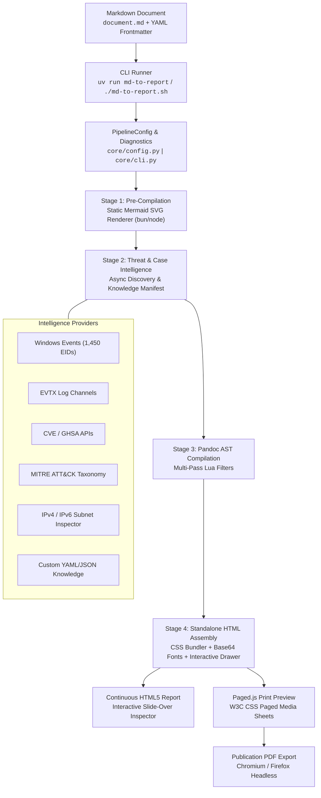

# System Architecture

The `md-style` toolchain is a modular document processing engine designed to transform Markdown source files into self-contained, publication-grade HTML5 reports and PDF documents.

---

## 1. High-Level System Architecture

The processing architecture consists of a Python orchestration layer (`core/`), native CLI runners powered by [`uv`](https://github.com/astral-sh/uv), Pandoc multi-pass AST filters written in Lua, and a standalone client-side delivery runtime.



---

## 2. The 4-Stage Pipeline

Every document processed by `md-style` transitions through four distinct execution stages managed by [`core/engine.py`](file:///home/valor/Devel/personal/md-style/core/engine.py):

### Stage 1: Pre-Compilation & Diagram Rendering
- **Objective**: Ensure 100% offline self-containment for diagrams and visual assets before Pandoc touches the document.
- **Implementation**: [`core/diagrams/mermaid.py`](file:///home/valor/Devel/personal/md-style/core/diagrams/mermaid.py) scans the Markdown source for ```` ```mermaid ```` code blocks.
- **Execution**: Invokes `@mermaid-js/mermaid-cli` (`mmdc`) via `bun` or `node`.
- **Output**: Each diagram is rendered to an isolated, optimized SVG file. The Markdown source block is replaced with an embedded image reference (``).
- **Caching**: Diagram source hashes are tracked to bypass re-rendering unchanged diagrams.

### Stage 2: Threat & Case Intelligence Resolution
- **Objective**: Identify all security indicators, event identifiers, log channels, and custom entities in the document and resolve their enriched metadata.
- **Implementation**: [`core/inspector.py`](file:///home/valor/Devel/personal/md-style/core/inspector.py) orchestrates an array of specialized enrichers:
  - `WindowsEventsEnricher`: Matches numeric and prefixed Event IDs (`EID 5001`, `Event ID 4624`, compound lists `EID 21/23`).
  - `EvtxEnricher`: Resolves `.evtx` channels and common forensic shorthand (`Defender.evtx`, `TerminalServices.evtx`).
  - `CveEnricher`: Queries National Vulnerability Database (NVD) / Mitre for CVE metadata.
  - `GhsaEnricher`: Queries GitHub Security Advisory GraphQL database.
  - `MitreEnricher`: Maps MITRE ATT&CK technique IDs (e.g. `T1562.001`).
  - `NetworkEnricher`: Classifies IPv4/IPv6 addresses, isolates RFC 1918 private subnets, and enforces OPSEC policies.
  - `CustomKnowledgeEnricher`: Ingests case-specific YAML/JSON definitions from `knowledge/` or `kb/`.
- **Manifest Serialization**: Resolves threat intelligence in parallel, writes a temporary JSON manifest (`knowledge-manifest.json`), and tracks verified vs. unresolved indicators.

### Stage 3: Pandoc AST Multi-Pass Compilation
- **Objective**: Parse the Markdown syntax into Pandoc's Abstract Syntax Tree (AST), transform indicators into interactive HTML pills, and render structural elements.
- **Implementation**: Executed via `pandoc` using specialized Lua filters (e.g. [`styles/forensic-cyber.lua`](file:///home/valor/Devel/personal/md-style/styles/forensic-cyber.lua), [`styles/svj/ballot.lua`](file:///home/valor/Devel/personal/md-style/styles/svj/ballot.lua)).
- **Multi-Pass Execution Guarantee**: To prevent race conditions where filters encounter inline code before loading metadata manifests, filters use multi-pass tables:
  ```lua
  return {
    { Meta = Meta },                                                  -- Pass 1: Load manifests & frontmatter
    { Code = Code, Inlines = Inlines, BlockQuote = BlockQuote },       -- Pass 2: Tag indicators & callouts
    { Pandoc = Pandoc }                                               -- Pass 3: Inject KB scripts & finalize
  }
  ```
- **Prose Punctuation Stripping**: Isolates leading and trailing punctuation (e.g., `(Event ID 5001)`) so pills are tagged cleanly without breaking surrounding sentences.

### Stage 4: Standalone Assembly & Post-Processing
- **Objective**: Package the document into a single, zero-dependency HTML file that can be archived, emailed, or opened offline.
- **Implementation**:
  - **CSS Bundling**: Inlines the base stylesheet (`styles/base.css`), theme stylesheet (`styles/<family>/<theme>.css`), and print layout (`styles/paged.css`).
  - **Base64 Font Inlining**: Inlines local web fonts (`styles/fonts.css`) including *Roboto Slab*, *Merriweather*, and *JetBrains Mono*.
  - **Localization Injection**: Injects localized CSS custom properties into `:root` and serializes the merged i18n dictionary into `<script id="report-i18n" type="application/json">`.
  - **Threat Knowledge Serialization**: Injects all resolved indicator metadata into `<script id="cyber-kb-data" type="application/json">`.
  - **Client-Side Runtime**: Appends the interactive slide-over inspector drawer template ([`templates/forensic-cyber-interactive.html`](file:///home/valor/Devel/personal/md-style/templates/forensic-cyber-interactive.html)).

---

## 3. Native Python CLI Layer via `uv`

The toolchain is built with Python 3.10+ and managed via [`uv`](https://docs.astral.sh/uv/) for high-speed dependency resolution and deterministic execution.

### Entrypoints
The package defines console scripts in [`pyproject.toml`](file:///home/valor/Devel/personal/md-style/pyproject.toml):
```toml
[project.scripts]
md-to-report = "core.cli:main"
md-style = "core.cli:main"
```

### Backwards-Compatible POSIX Wrapper
The repository root contains [`md-to-report.sh`](file:///home/valor/Devel/personal/md-style/md-to-report.sh), a lightweight two-line POSIX shell script forwarding all invocations to `uv run md-to-report "$@"`. This preserves existing CI/CD pipelines, shell aliases, and automated build scripts without requiring manual environment activation.

### CLI Diagnostics & Inspection
The CLI provides rich terminal output via [`core/diagnostics.py`](file:///home/valor/Devel/personal/md-style/core/diagnostics.py):
- `--inspect`: Dry-run mode that parses frontmatter, catalogs threat indicators, loads custom knowledge, and displays a summary table without invoking Pandoc.
- `--list-styles`: Discovers and prints all available theme stylesheets and style families.
- Build Warnings: Warns if indicators cannot be verified offline with actionable guidance.

---

## 4. Hierarchical Style Families

Styles are organized into logical domain families that share base CSS, Lua filters, and localization catalogs:

```text
styles/
├── base.css                      # Universal typography, margins, and resets
├── fonts.css                     # Embedded base64 font definitions
├── paged.css                     # W3C CSS Paged Media print rules & polyfill framing
├── forensic/                     # Forensic & Cyber Security family
│   ├── base.css                  # Shared forensic typography & evidence styling
│   ├── dossier.css               # Classic physical forensic investigation layout
│   ├── cyber.css                 # Dark HUD, threat indicator pills, inspector drawer
│   ├── forensic.lua              # Evidence chain of custody & timeline filter
│   └── cyber.lua                 # Cyber IoC pill extractor & callout filter
└── svj/                          # Homeowners Association (SVJ) family
    ├── base.css                  # Shared Czech legal typography & notices
    ├── modern.css                # Clean corporate assembly invitation
    ├── community.css             # Friendly neighborhood bulletin
    ├── typewriter.css            # Archival monospaced legal notice
    ├── ballot.css                # Voting ballot & quorum layouts
    └── ballot.lua                # Per-proposal voting ballot generator
```

### Backward Compatibility Aliases
The CLI and frontmatter parser support both hierarchical paths and legacy dash-delimited names:
- `-s forensic/cyber` $\equiv$ `-s forensic-cyber`
- `-s forensic/dossier` $\equiv$ `-s forensic`
- `-s svj/modern` $\equiv$ `-s svj-modern`
- `-s svj/ballot` $\equiv$ `-s svj-ballot`

---

## 5. Security & OPSEC Principles

1. **Zero Runtime Web Requests**: The compiled HTML report contains all scripts, stylesheets, fonts, and data inline. When opened in an isolated network or forensic air-gap, it makes zero network connections.
2. **Private Network Protection**: RFC 1918 and loopback IP addresses strictly suppress external threat queries (VirusTotal, AbuseIPDB) to prevent accidental data leaks during customer investigations.
3. **Deterministic Caching**: Dynamic intelligence lookups (Microsoft Learn, Ultimate Windows Security) are cached in `data/cache/` to ensure builds remain reproducible and fast even when offline.
