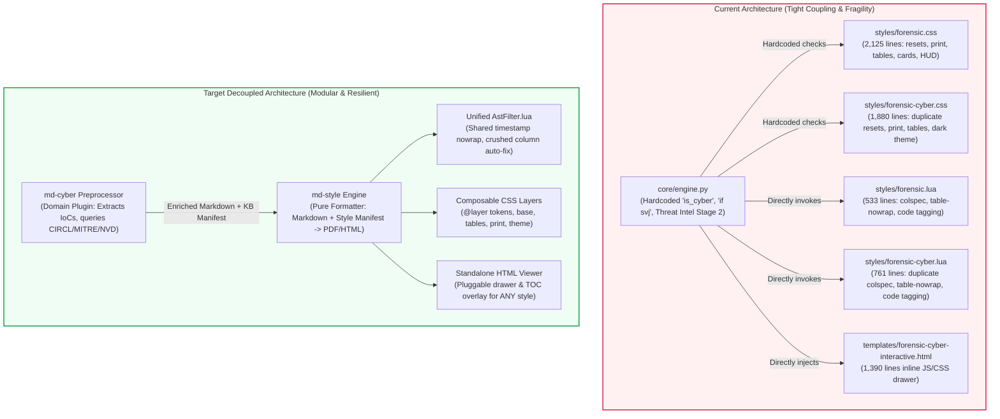

# Architectural Assessment & Decoupling Plan: From Monolith to Composable Design System

---

## 1. Executive Summary & Diagnostic Assessment

### The User's Core Concern
> *"Is the architecture, after Step 1 and Step 2, still ok? Pandoc seems to be doing fine, but at the same time, it feels that the styles are so complex and intertwined that any changes to the core can result in more and more bugs."*

### The Verdict: **Your Instinct is 100% Correct.**

While **Step 1** (eliminating `pdflatex` via Headless Chromium) and **Step 2** (native GFM alerts & removing `callouts.lua`) significantly strengthened the rendering engine, **the codebase currently suffers from architectural coupling and monolithic style duplication**. 

The reason fixing a bug in one place (e.g., frontmatter parsing or inline word-wrapping) threatens to break other styles is directly traceable to **four fundamental design smells**:



---

## 2. Root Cause Analysis: The 4 Structural Traps

### Trap 1: The "Omniscient" Core Engine
[`core/engine.py`](file:///home/valor/Devel/personal/md-style/core/engine.py) currently attempts to be everything:
- **It is a document formatter** (running Pandoc, compiling Chromium PDFs).
- **It is a cybersecurity threat engine** (importing `registry`, resolving CVEs, MITRE ATT&CK, Windows event logs, and querying external APIs in Stage 2).
- **It hardcodes theme names**:
  ```python
  # In core/engine.py lines 209-210, 316-319, 357:
  is_cyber = (style_name == "forensic-cyber" or "cyber" in style_name)
  if "svj" in style_name: ...
  elif style_name.startswith("forensic"): ...
  ```
**Why this causes bugs**: When you format a simple school report, an SVJ meeting notice, or an invitation, the engine still executes threat registry logic or risks style leakages. If a generic feature is altered, domain-specific behavior breaks.

---

### Trap 2: The Monolithic CSS Duplication
The codebase has 7,400+ lines of CSS. Over **55%** of all CSS resides in just two files:
- [`styles/forensic.css`](file:///home/valor/Devel/personal/md-style/styles/forensic.css): **2,125 lines**
- [`styles/forensic-cyber.css`](file:///home/valor/Devel/personal/md-style/styles/forensic-cyber.css): **1,880 lines**

Both files re-implement from scratch:
1. CSS Resets & font definitions
2. Table layouts, zebra striping, and timestamp wrapping
3. Full `@media print` rules, margin boxes, and page counters
4. Callouts, badges, and code styling
5. Over 80 `!important` overrides each

**Why this causes bugs**: When you fix a word-wrapping bug or pagination issue in `forensic.css`, `forensic-cyber.css` remains broken unless manually mirrored. The high usage of `!important` turns every styling adjustment into a specificity war.

---

### Trap 3: Forked Lua AST Filters
We currently maintain three separate Lua filters that contain 70% identical Lua AST manipulation logic:
- [`filters/table-nowrap.lua`](file:///home/valor/Devel/personal/md-style/filters/table-nowrap.lua) (204 lines)
- [`styles/forensic.lua`](file:///home/valor/Devel/personal/md-style/styles/forensic.lua) (533 lines)
- [`styles/forensic-cyber.lua`](file:///home/valor/Devel/personal/md-style/styles/forensic-cyber.lua) (761 lines)

All three define `is_timestamp_str()`, `is_timestamp_header()`, colspec normalization, and `Code(el)` hooks. 

**Why this causes bugs**: In the previous session, `filters/table-nowrap.lua` was forgotten in `core/engine.py` because the engine author assumed the style-specific Lua filter would handle it, while other styles were left without nowrap protection.

---

### Trap 4: Monolithic Interactive Overlay Template
[`templates/forensic-cyber-interactive.html`](file:///home/valor/Devel/personal/md-style/templates/forensic-cyber-interactive.html) is **1,390 lines** containing the HUD bar, the IoC inspector drawer, the theme switcher, section navigation, and search filtering.
- It is tightly coupled only to `forensic-cyber`.
- Yet as the user noted, *the interactive viewer overlay could provide immense value to legal dossiers, technical documentation, or audit reports*.
- Because it is glued to cyber styles, it cannot be reused cleanly elsewhere.

---

## 3. The Target Clean Architecture

To permanently resolve this fragility, we propose a 4-layer clean architecture:

```
┌────────────────────────────────────────────────────────────────────────┐
│ Layer 1: Domain Preprocessors (e.g. `md-cyber`)                        │
│ - Scans text for domain tokens (IoCs, CVEs, statutes, case law)       │
│ - Enriches metadata offline/online, writes JSON knowledge manifest     │
└───────────────────────────────────┬────────────────────────────────────┘
                                    │ (Clean Markdown + manifest.json)
                                    ▼
┌────────────────────────────────────────────────────────────────────────┐
│ Layer 2: Core Formatter (`md-style`)                                   │
│ - Pure Pandoc + Headless Chromium engine                               │
│ - Completely domain-agnostic (0 mentions of CVE, MITRE, or SVJ)        │
│ - Driven by declarative Style Manifests (`style.yaml`)                 │
└───────────────────────────────────┬────────────────────────────────────┘
                                    │
         ┌──────────────────────────┴──────────────────────────┐
         ▼                                                     ▼
┌──────────────────────────────────────┐     ┌───────────────────────────────────┐
│ Layer 3: Composable CSS Design System│     │ Layer 4: Pluggable Viewer Overlay │
│ - base/tokens.css                    │     │ - Standalone JS/CSS Drawer & HUD  │
│ - base/tables.css                    │     │ - Generic key-value inspection    │
│ - base/print.css (A4/Letter Paged)   │     │ - Reusable across ANY document    │
│ - themes/{forensic,cyber,school}.css │     └───────────────────────────────────┘
└──────────────────────────────────────┘
```

---

## 4. Step-by-Step Refactoring Plan

### Phase 1: Declarative Style Manifests (`style.yaml`)
**Goal**: Remove all hardcoded style branches (`is_cyber`, `if "svj" in style_name`) from [`core/engine.py`](file:///home/valor/Devel/personal/md-style/core/engine.py).

Each style directory will define a lightweight `style.yaml`:
```yaml
# styles/forensic/style.yaml
name: forensic
title: "Official Forensic Report"
css:
  - ../base/tokens.css
  - ../base/typography.css
  - ../base/tables.css
  - ../base/print.css
  - theme.css
lua_filters:
  - ../filters/table-nowrap.lua
  - ./forensic-kpi.lua
header_includes:
  - ../templates/paged-header.html
viewer:
  enabled: true
  template: default-inspector
```

`core/engine.py` simply loads the manifest and builds the Pandoc argument list dynamically.

---

### Phase 2: Modularize the CSS Design System
**Goal**: Break down `forensic.css` (2,125 lines) and `forensic-cyber.css` (1,880 lines) into composable CSS `@layer` modules.

1. **`styles/base/tokens.css`**: Design tokens, font stacks, shared border-radius, standard alert colors.
2. **`styles/base/tables.css`**: All table rules, zebra backgrounds, responsive wrappers, and the strict timestamp nowrap rules:
   ```css
   @layer base {
     td.nowrap, th.nowrap, .nowrap, .nowrap * {
       white-space: nowrap !important;
       word-break: keep-all !important;
       overflow-wrap: normal !important;
     }
     code:not(pre code), kbd, samp, .pill, .badge {
       white-space: nowrap !important;
       word-break: keep-all !important;
       overflow-wrap: normal !important;
     }
     code.hash, .hash, code.break-all, .break-all {
       white-space: normal !important;
       word-break: break-all !important;
       overflow-wrap: anywhere !important;
     }
   }
   ```
3. **`styles/base/print.css`**: Pure print engine for Chromium: page margins, running headers, break-inside prevention, and screen UI suppression.
4. **`styles/themes/forensic/theme.css`**: Only forensic-specific aesthetics (~250 lines): the title block header layout, examiner metadata box, and executive summary styling.
5. **`styles/themes/cyber/theme.css`**: Only the dark neon palette and radar scanline animations (~300 lines).

**Benefit**: If word-wrapping or print margins are adjusted in `styles/base/tables.css` or `print.css`, **all styles inherit the fix instantly without code duplication**.

---

### Phase 3: Consolidate Lua AST Filters
**Goal**: Merge duplicate Lua filters into reusable, single-responsibility filters:
- **`filters/table-nowrap.lua`**: Handles table timestamp detection, column width un-crushing, and auto-tagging long hashes with class `.hash`.
- **`filters/token-highlighter.lua`**: Reads a generic `knowledge-manifest.json` and wraps matching tokens in `<code class="..." data-type="..." data-val="...">`.
- Remove `styles/forensic.lua` and `styles/forensic-cyber.lua` in favor of these shared filters.

---

### Phase 4: Standalone Interactive Document Viewer
**Goal**: Decouple `templates/forensic-cyber-interactive.html` into a universal, standalone interactive viewer (`templates/interactive-viewer.html`):
- Operates on any `<span/code class="inspectable" data-type="..." data-val="...">`.
- Reads generic JSON data from `<script id="doc-knowledge-base" type="application/json">`.
- Can display CVEs, MITRE techniques, legal statutes, chemical CAS numbers, financial line-items, or dictionary glossaries.
- Activated via `--viewer` or `viewer: true` in the document frontmatter or style manifest.

---

### Phase 5: Decouple `md-cyber` Preprocessor
**Goal**: Separate domain intelligence into its own module or CLI wrapper:
- `md-cyber preprocess incident.md -o incident-enriched.md --manifest kb.json`
- `md-style incident-enriched.md --kb kb.json -s cyber -o incident.html`
- Or bundled together seamlessly via a unified pipeline command:
  `md-to-report incident.md --enrich cyber -o incident.pdf`

---

## 5. Verification & Safety Strategy

To guarantee that refactoring does not break existing reports:
1. **Automated Visual Regression Baseline**:
   - Save baseline PDFs: `output/baseline-pozvanka.pdf`, `output/baseline-school.pdf`, `output/baseline-forensic.pdf`, `output/baseline-cyber.pdf`.
   - Run `pdftoppm` to extract PNG pages and verify that page count, layout, and visual fidelity match 100%.
2. **Interactive HTML Verification**:
   - Run headless browser tests to ensure the inspector drawer opens on click, theme switcher toggles between dark/light, and search filtering operates.
3. **No-Regression Checklist**:
   - [ ] YAML frontmatter parses correctly with zero header breakage.
   - [ ] Inline code tokens (`NT AUTHORITY\SYSTEM`, `DC-CORP-01`, `198.51.100.44`) do not wrap across lines.
   - [ ] Hashes (`a3c5f891...`, `d41d8cd...`) wrap cleanly without breaking table widths.
   - [ ] Print mode hides all HUD/drawer elements and respects page breaks.

---

## 6. Recommendations for User Alignment

> [!IMPORTANT]
> **Should we proceed with this modularization?**
>
> 1. **Option A (Recommended: In-Place Modularization)**:
>    Keep the repository unified for now, but execute **Phases 1, 2, and 3** (declarative style manifests, modular CSS `@layer` design system, and unified Lua filters). This eliminates 3,000+ lines of duplicate code, stops regression bugs, and keeps the build fast and simple.
>
> 2. **Option B (Full Hard Split into Two Repositories)**:
>    Immediately split into `md-style` (pure Pandoc/Chromium formatter) and `md-cyber` (standalone Python intel CLI). This is the cleanest long-term boundary, but requires maintaining two packages/repos.
>
> 3. **Option C (Minimal Stabilization)**:
>    Keep the current architecture as is, and only add targeted tests to protect against regressions without refactoring the CSS or engine.

Which path would you like to take?
