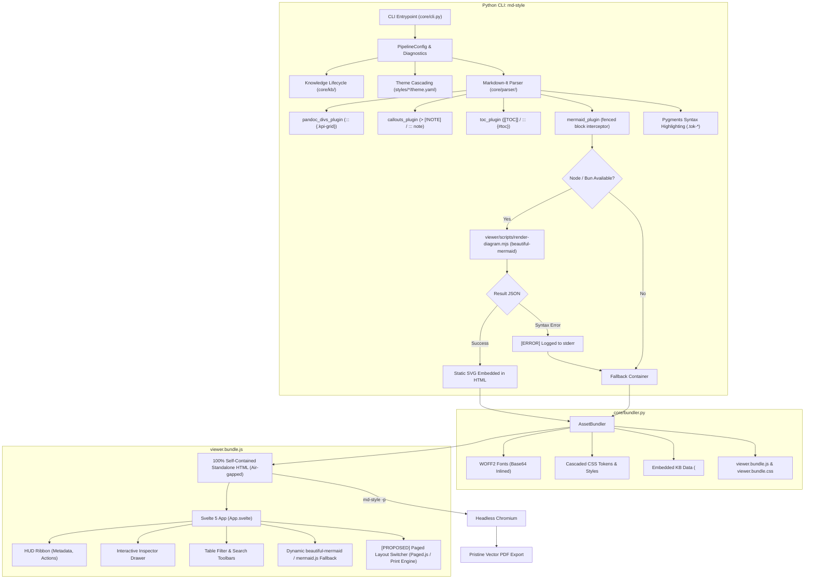
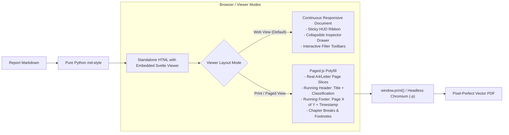

# Architectural Review: Stack Evaluation, Framework Trade-offs, and Viewer-Native Paged Printing

## 1. Executive Summary & Goal

This architectural review addresses four fundamental questions regarding the evolution of `md-style`:
1. **Current Architecture Verification**: Assessment of Knowledge Packs, pure-Python pipeline, package-managed Mermaid integration, and declarative CSS theme cascading.
2. **Pure TypeScript/JavaScript vs. Pure Python vs. Hybrid**: Whether migrating the entire engine to Node/TypeScript provides tangible advantages.
3. **Evaluation of Frameworks (Astro vs. Vite/Svelte)**: Whether adopting Astro as the core compiler would improve the authoring and rendering experience.
4. **Viewer-Native Paged Print Media (Running Headers, Footers & Page Counters)**: How to integrate paged output directly into the Svelte viewer (`viewer.bundle.js`) so that standalone HTML files and PDF exports always produce publication-grade printed pages with running headers, footers, and page numbers without external Pandoc/Weasyprint/typst dependencies.

---

## 2. In-Depth Architecture Verification

### Current State Matrix



### Strengths of the Current Architecture:
- **Instant Compilation**: Python processes Markdown in ~30ms–80ms.
- **True Portability**: Inlines WOFF2 fonts, SVG icons, Pygments syntax highlighting, and the Svelte viewer into a single standalone HTML file. Works completely offline in secure air-gapped environments.
- **Maintainable Dependencies**: `beautiful-mermaid` and `mermaid` are managed via `viewer/package.json` with standard `npm audit` vulnerability tracking. Zero binary blobs in `vendor/`.
- **Diagnostic Feedback**: Direct compilation errors on `sys.stderr` with line numbers and diagram IDs.

---

## 3. Technology Stack Trade-Off Analysis

### Question A: Would it help if the entire project was written in JavaScript / TypeScript?

| Evaluation Dimension | Current Hybrid (Python CLI + TS Viewer) | Pure JavaScript / TypeScript (Node / Bun / Deno) |
| :--- | :--- | :--- |
| **Runtime Dependencies** | Requires Python $\ge$ 3.10 and Node $\ge$ 18 (for diagram rendering & viewer build). | Single runtime (Node.js or Bun). Single `package.json`. |
| **Target Audience Alignment** | **Optimal**: Target users are DFIR analysts, security engineers, systems architects where Python is the universal standard (`pip install md-style` / `uvx md-style`). | Good for web developers, but security operations workstations often restrict Node or have older Node versions. |
| **Data Science / KB Integration** | Native access to Python security libraries, STIX/TAXII, MITRE ATT&CK, YARA, pandas, openpyxl. | Requires porting or using JS equivalents for Excel/STIX parsing. |
| **Internal IPC Overhead** | Subprocess pipe to Node for `beautiful-mermaid` (~150ms). | Zero IPC; `beautiful-mermaid` and markdown parsers execute in the same memory heap. |
| **Distribution / Packaging** | Dual package setup (Python package + pre-bundled assets in `core/assets/`). | Single `npm` package or compiled standalone binary (via Bun compile or pkg). |

> [!NOTE]
> **Verdict on Pure TypeScript**:
> A pure TypeScript port is technically feasible and eliminates the dual-runtime requirement. However, for a **security and forensics documentation tool**, keeping Python as the host CLI language while bundling compiled JavaScript assets into `core/assets/` provides the best developer experience for Python/DFIR practitioners while leveraging the modern JS web ecosystem.

---

### Question B: What if Astro framework was involved?

Astro is an outstanding content-driven static site generator with an "Islands Architecture". However, evaluating Astro for `md-style`'s specific use case reveals significant impedance mismatches:

1. **Astro is Multi-File by Design**:
   - Astro compiles projects into directories containing hundreds of chunks: `dist/index.html`, `dist/_astro/hoisted.xxxx.js`, `dist/_astro/client.xxxx.css`.
   - `md-style`'s core requirement is generating **a single, standalone, 100% self-contained HTML file** that analysts can email, upload to tickets, or archive air-gapped without external assets.
   - Bundling Astro's output into a single self-contained HTML requires aggressive Vite plugins (`vite-plugin-singlefile`) which frequently break Astro's internal script hoisting and CSS code-splitting.
2. **CLI Document Generation vs. Website Building**:
   - Astro is designed to build whole websites from a fixed directory structure (`src/pages/*.astro`, `src/content/`).
   - `md-style` is a command-line tool executed on arbitrary files in arbitrary directories: `md-style /var/log/incident-report.md -o output.html`.
   - Running Astro programmatically on an ad-hoc markdown file requires launching the Astro build engine, which incurs a **2.5s–5.0s startup tax** per file, compared to ~50ms in our direct parser.
3. **Verdict on Astro**:
   - **Not recommended** for the ad-hoc document CLI compiler.
   - Svelte 5 + Vite IIFE library build currently compiled into `core/assets/viewer.bundle.js` is significantly faster, leaner, and purpose-built for standalone document embedding.

---

## 4. Proposed Feature: Viewer-Native Paged Printing & Running Headers/Footers

### The Core Problem in Modern Browsers:
- CSS Paged Media standards (`@page { @top-center { ... }; @bottom-right { ... }; }`) are **not supported by standard Chromium, Firefox, or Safari**.
- If a user opens `report.html` in Chrome and presses `Ctrl + P` (or prints to PDF), Chromium ignores CSS margin boxes, page counter resets, and running headers.
- Previously, tools relied on heavy external engines like WeasyPrint (Python/Cairo), Typst, or Pandoc + LaTeX.

### The Solution: Embedded Paged Layout Engine in `viewer.bundle.js`
We can incorporate **Paged.js** (the W3C-compliant Paged Media polyfill) directly into the Svelte viewer:



### Key Capabilities of Viewer-Native Paged Mode:
1. **Always Bundled & Zero External Binaries**:
   - `pagedjs` added to `viewer/package.json` (`npm i pagedjs`).
   - Compiled directly into `viewer.bundle.js`. No Node/Python paged binary needed.
2. **Dual-Mode Layout Toggle in HUD Ribbon**:
   - A toggle button in the Svelte HUD Ribbon:
     - 🖥️ **Reading Mode (Continuous)**: Great for on-screen browsing, entity inspection, table filtering.
     - 📄 **Print Preview (Paged)**: Renders actual A4 sheet pages with shadows, margins, running headers, and footers on screen.
3. **Automated Running Headers & Footers**:
   - **Running Header**:
     - Left: Document Title / Logo.
     - Center: Classification Banner (`TLP:AMBER // CONFIDENTIAL` or `SVJ Pozvánka`).
     - Right: Current Chapter / Heading name.
   - **Running Footer**:
     - Left: Confidentiality notice / Author.
     - Center: Generation date & SHA-256 report fingerprint.
     - Right: Page counter (`Page 3 of 12` using real CSS page counters).
4. **Seamless Headless Chromium PDF Export**:
   - When running `md-style input.md -p -o output.pdf`:
     - Python launches Headless Chromium with query param or class `#paged-mode`.
     - The viewer renders the paged layout.
     - Chromium prints the exact pre-paginated layout into PDF with 100% fidelity.

---

## 5. Architectural Improvements & Action Plan

### Track 1: Integrate `pagedjs` into `viewer/`
1. Add `pagedjs: "^0.4.3"` to `viewer/package.json`.
2. Create `viewer/src/PagedViewer.svelte` or layout controller in `App.svelte`:
   - Listens to `@media print` or manual toggle button in `HudRibbon.svelte`.
   - Polyfills CSS Paged Media `@page` margin boxes (`@top-left`, `@top-right`, `@bottom-left`, `@bottom-center`, `@bottom-right`).
   - Supports CSS custom properties for header/footer text:
     ```css
     @page {
       size: A4;
       margin: 20mm 15mm 20mm 15mm;
       @top-left { content: "INCIDENT FORENSIC REPORT"; }
       @top-right { content: string(heading); }
       @bottom-left { content: "CONFIDENTIAL // TLP:AMBER"; }
       @bottom-right { content: "Page " counter(page) " of " counter(pages); }
     }
     ```

### Track 2: Knowledge Pack Resolver Extensions
- Support asynchronous online enrichers in Python via `md-style --enrich` (e.g. fetching CVE descriptions from NVD, MITRE ATT&CK enterprise v15, NIST NVD 2.0 API) while preserving offline cached operation by default.

### Track 3: Theme Development DX
- Add a theme validator CLI command: `md-style --check-theme forensic/cyber` that verifies CSS tokens and variables are consistent before compilation.

---

## 6. Verification Plan

1. **Viewer Build**:
   - Run `cd viewer && npm install && npm run build` to verify `pagedjs` bundles cleanly into `core/assets/viewer.bundle.js`.
2. **Paged Media Screen & Print Verification**:
   - Open `output/sample-forensic-report.html` in browser.
   - Click "Print Preview (Paged)" in the HUD ribbon.
   - Verify A4 page rendering with running headers (`#fig-` figures not split across page breaks, running headers showing report title, running footers showing "Page X of Y").
3. **Headless Chromium Vector PDF**:
   - Run `uv run md-style examples/sample-forensic-report.md -p -o output/sample-forensic-report.pdf`.
   - Inspect PDF: confirm vector sharpness, running headers, footers, and page numbers.
