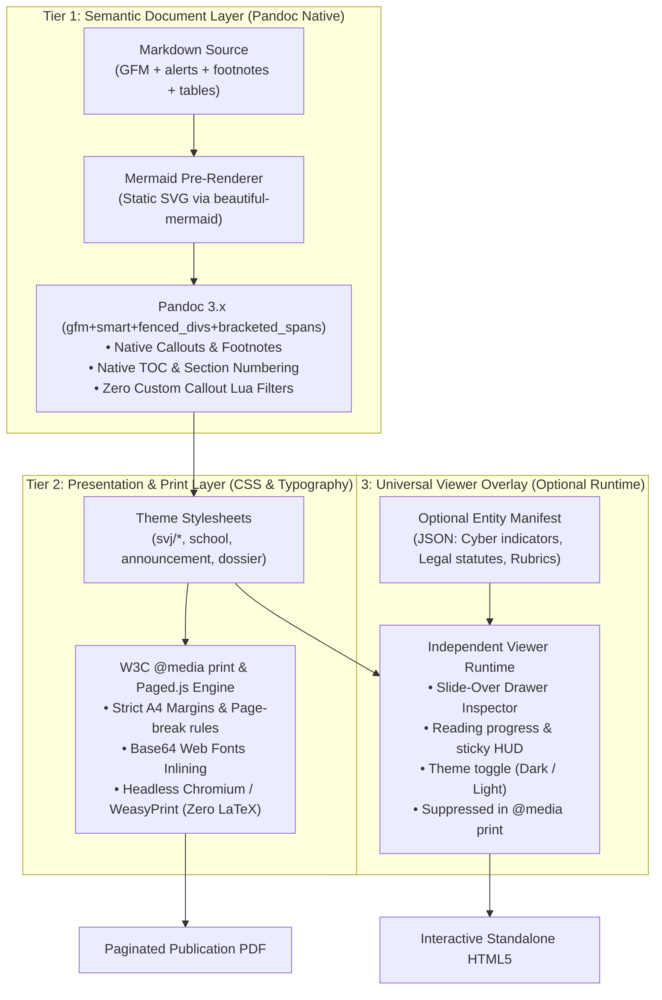

# Architecture Blueprint: Clean Pandoc GFM, Universal Viewer Overlay & Decoupled `md-cyber`

---

## 1. Executive Summary & Verification Findings

In response to the discussion on streamlining `md-style`, eliminating unnecessary Lua scripts, and treating the interactive drawer as an independent overlay, we conducted live testing against the local environment (**Pandoc 3.7.0.2**).

### Key Discovery: Pandoc Natively Handles GitHub Callouts & Footnotes
By configuring Pandoc with:
```bash
pandoc -f gfm+smart+fenced_divs+bracketed_spans ...
```
Pandoc natively handles almost all document features **without any custom Lua filters**:
1. **GitHub Alert Callouts (`> [!NOTE]`, `> [!TIP]`, `> [!WARNING]`, etc.)**:
   - Converted natively to `<div class="note"><div class="title"><p>Note</p></div>...</div>`.
   - All styling, color coding, and monochromatic icons can be driven **100% via standard CSS** in `styles/base.css`.
   - `filters/callouts.lua` and `vendor/octicons.lua` can be **completely eliminated**!
2. **Footnotes (`[^1]`)**:
   - Converted natively to `<a href="#fn1" class="footnote-ref"><sup>1</sup></a>` with an end-of-document `<section id="footnotes">` and back-links (`↩︎`).
   - Zero Lua required.
3. **Task Checklists (`- [x]`, `- [ ]`)**:
   - Converted natively to `<ul class="task-list"><li><input type="checkbox" checked />...</li></ul>`.
4. **Fenced Divs (`::: {.class}`) & Bracketed Spans (`[text]{.badge}`)**:
   - Natively supported via `+fenced_divs+bracketed_spans`, allowing meeting info cards, status badges, and entity pills without custom preprocessors.

---

## 2. The 3-Tier Layered Architecture

To achieve the user's vision—a document system that produces flawless printed pages, clean HTML, and an optional rich interactive viewer—we structure the architecture into three completely independent layers:



---

## 3. Resolving the Tension: Pure Formatter vs. Cyber Compiler

### 3.1 Project A: `md-style` (The Pure Formatter & Publisher)
`md-style` returns to being a focused, lightweight toolchain.

- **Input**: Standard Markdown (GFM syntax).
- **Core Pipeline**:
  1. `MermaidRenderer`: Replaces ```` ```mermaid ```` with optimized, static inline SVGs.
  2. `i18n Engine`: Cascades Babel/CLDR locale strings into Pandoc metadata and CSS custom properties (`--i18n-...`).
  3. `Pandoc Compiler`: Compiles GFM to HTML5. Zero cyber logic.
  4. `Print & PDF Engine`:
     - If output is `.pdf` (or `--pdf` flag), routes intermediate standalone HTML directly to headless Chromium or WeasyPrint.
     - **Fix**: Never passes `.pdf` to Pandoc directly, preventing Pandoc from invoking `pdflatex`.
- **Optional Universal Viewer Overlay**:
  - If `--interactive` (or if `--manifest <file.json>` is passed), `md-style` injects the universal slide-over viewer runtime.
  - The viewer is **domain-agnostic**:
    - For cyber reports: Shows MITRE TTPs and Windows Event details.
    - For SVJ assembly notices: Shows legal references (*NOZ § 1200*), quorum bylaws, and building maps.
    - For academic reports: Shows evaluation rubrics and course competencies.
  - In `@media print`, the viewer overlay has `display: none !important;`, guaranteeing that the physical/PDF printout remains clean, paginated paper.

### 3.2 Project B: `md-cyber` (The Cyber DFIR Case & Intelligence Preprocessor)
`md-cyber` becomes an upstream specialized tool for security analysts:
- Holds the 1,450 Windows Event IDs database, MITRE ATT&CK taxonomy, CVE/GHSA query caches, and EVTX parser.
- Inspects evidence, logs, and case notes.
- Ingests case-specific YAMLs (`knowledge/*.yaml`).
- Prepares:
  1. The annotated Markdown report.
  2. The compiled entity manifest (`manifest.json`).
- Hands both to `md-style` for final compilation:
  ```bash
  md-style incident.md --manifest manifest.json --style forensic-cyber -o report.pdf
  ```

---

## 4. Elimination of Redundant Code

By embracing native Pandoc GFM and an overlay architecture, we can immediately remove significant technical debt:

| Current Component | Status | Replacement |
|---|---|---|
| [`filters/callouts.lua`](file:///home/valor/Devel/personal/md-style/filters/callouts.lua) | 🗑️ **Delete** | Handled natively by Pandoc `gfm` (`+alerts`) + CSS styling in `base.css` |
| [`vendor/octicons.lua`](file:///home/valor/Devel/personal/md-style/vendor/octicons.lua) | 🗑️ **Delete** | Icons rendered via pure CSS data-URIs or SVGs |
| `core/engine.py` hardcoded `is_cyber` | 🗑️ **Delete** | Replaced by generic `--interactive` and `--manifest` flags |
| Pandoc `pdflatex` fallback | 🛠️ **Fixed** | Automatic redirection to headless browser / WeasyPrint |
| Screen HUD in print | 🛠️ **Fixed** | Strict `@media print { display: none !important; }` isolation |

---

## 5. Execution Roadmap


### Step 1: Fix PDF Engine & Print Pagination (Immediate Priority)
- Detect `.pdf` output extension and force `generate_pdf = True`.
- Generate temporary standalone HTML with `--embed-resources`.
- Invoke headless Chromium (`--print-to-pdf`) or WeasyPrint.
- Add strict print suppression for any interactive controls.

### Step 2: Switch Pandoc to GFM & Streamline Filters
- Change Pandoc invocation from `markdown+smart+gfm_auto_identifiers+pipe_tables` to `gfm+smart+fenced_divs+bracketed_spans`.
- Verify native alerts (`> [!NOTE]`, `> [!WARNING]`, etc.) and footnotes (`[^1]`).
- Remove `filters/callouts.lua` and `vendor/octicons.lua`.
- Style native `.note`, `.warning`, `.tip`, `.important`, `.caution` classes in `styles/base.css`.

### Step 3: Implement the Universal Viewer Overlay
- Refactor the interactive drawer template into `templates/viewer-overlay.html`.
- Read entity definitions from a standardized `<script id="doc-manifest" type="application/json">`.
- Allow any style to activate the viewer via `--manifest` or `--interactive`.

### Step 4: Extract `md-cyber`
- Relocate `core/enrichers/`, `core/providers/`, and `data/*.json` into a dedicated package/directory (`cyber/` or independent repo).
- Ensure `md-style` has zero security datasets in its core.
