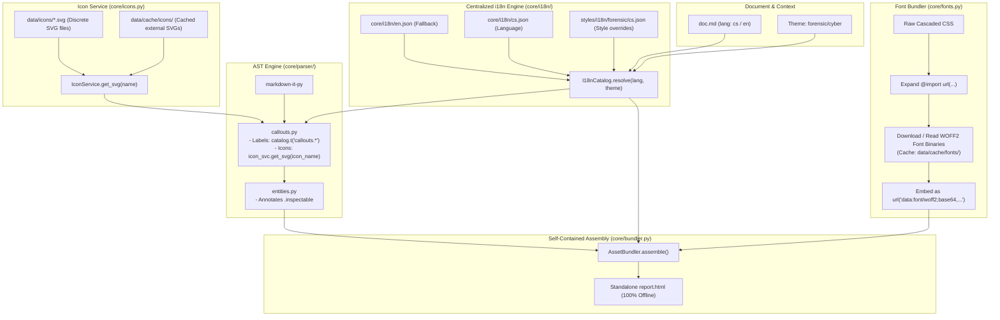

# Implementation Plan: Legacy Cleanup, Systematic i18n, Externalized Icons & Self-Contained Font Bundling

---

## 1. Goal Description

This design plan refines `md-style` v3 with four core improvements:
1. **Repository Cleanup**:
   - Completely remove dead Pandoc/Lua artifacts: [`filters/`](file:///home/valor/Devel/personal/md-style/filters), leftover root `.css` files in [`styles/`](file:///home/valor/Devel/personal/md-style/styles), obsolete Lua files ([`styles/svj/ballot.lua`](file:///home/valor/Devel/personal/md-style/styles/svj/ballot.lua), `vendor/octicons.lua`), legacy templates in [`templates/`](file:///home/valor/Devel/personal/md-style/templates), and obsolete enricher/provider modules in `core/` ([`core/enrichers/`](file:///home/valor/Devel/personal/md-style/core/enrichers), [`core/providers/`](file:///home/valor/Devel/personal/md-style/core/providers), `core/knowledge.py`, `core/inspector.py`).
2. **Systematic i18n Architecture**:
   - Replace hardcoded bilingual strings scattered across Python code with a centralized, cascading **`I18nCatalog`** powered by Python's `Babel` and structured locale catalogs (`core/i18n/{lang}.json`).
   - Deliver localized UI strings to the Svelte interactive viewer via `<script id="md-style-i18n" type="application/json">` so that the HUD, inspector drawer, and table filter controls automatically match the document language (`cs`, `en`, `de`, `sk`).
3. **Externalized Icon Service (Zero Hardcoded SVGs in Python)**:
   - Remove all hardcoded SVG strings from Python code.
   - Implement [`IconService`](file:///home/valor/Devel/personal/md-style/core/icons.py) that loads clean standalone SVG asset files from `data/icons/{name}.svg` or fetches from official icon CDNs (Octicons / FontAwesome / Lucide) and persistently caches them in `data/cache/icons/`.
4. **100% Self-Contained Font Bundling (Matching Pandoc `--embed-resources`)**:
   - Implement [`FontBundler`](file:///home/valor/Devel/personal/md-style/core/fonts.py) to parse CSS `@import` declarations, download/read `.woff2` font files, and embed them directly into `@font-face { src: url("data:font/woff2;base64,...") }`.
   - Ensure the output HTML has **zero external network dependencies** and renders custom typography offline.

---

## 2. Exhaustive Manifest: What Gets Bundled into the Final HTML

To ensure total transparency, here is the exact, specific inventory of every resource inlined into the standalone output file:

| Category | Source File(s) / Origin | Inlining Method | Offline Behavior |
| :--- | :--- | :--- | :--- |
| **Typography & Fonts** | Google Fonts (`JetBrains Mono`, `Roboto Slab`, `Merriweather`, etc.) or local fonts in `data/fonts/` | Converted to **base64 WOFF2** inside `@font-face { src: url("data:font/woff2;base64,...") }` | 100% offline; custom typography displays without network connection |
| **Theme Stylesheets** | Cascaded theme CSS (`styles/base/base.css`, `styles/forensic/cyber/cyber.css`, etc.) | Inlined into `<style>` block | Fully contained |
| **CSS Custom Properties** | Computed `:root { --bg-primary: ...; --accent: ...; }` | Inlined into `<style>` block | Fully contained |
| **Svelte Viewer CSS** | `core/assets/viewer.bundle.css` | Inlined into `<style>` block | Fully contained |
| **Vector Icons (Callouts)** | Standalone SVG files in `data/icons/*.svg` (loaded by `IconService`) | Inlined as `<svg class="callout-icon">` | Crisp vector graphics, no external icon font required |
| **Mermaid Diagrams** | Pre-rendered via `MermaidRenderer` / `beautiful-mermaid` | Inlined as native `<svg>` blocks | Zero client-side JavaScript diagram library needed |
| **Document Images** | Local image files (``, ``) | Inlined as `data:image/png;base64,...` | Embedded directly in document DOM |
| **Knowledge Pack Data** | `doc.kb.json` (CVE, MITRE, Event IDs, internal assets, provenance) | Inlined into `<script id="md-style-kb-data" type="application/json">` | Accessible to offline browser inspector |
| **i18n Translation Catalog** | Active locale strings (`core/i18n/{lang}.json` + theme overrides) | Inlined into `<script id="md-style-i18n" type="application/json">` | Localizes viewer UI without runtime locale fetching |
| **Interactive Viewer Runtime** | `core/assets/viewer.bundle.js` (pre-compiled Svelte 5 application) | Inlined into `<script>` tag before `</body>` | Zero external JS bundles, zero NPM dependencies for end users |

**Result**: The generated HTML file requires **0 HTTP requests, 0 CDN links, 0 external font requests**. It opens instantly in an air-gapped environment.

---

## 3. Architecture & Data Flow

---

## 4. Proposed Changes

### Phase 1: Repository Cleanup & Deletion of Dead Artifacts

#### [DELETE] `filters/`
Remove `filters/octicons.lua`, `filters/svj-prep.lua`, and the directory `filters/`.

#### [DELETE] `templates/`
Remove `templates/paged-header.html`, `templates/print-action.html`, and `templates/`.

#### [DELETE] Legacy flat files in `styles/`
Remove flat CSS files from root `styles/` that were migrated into theme folders:
- `styles/announcement.css`
- `styles/base.css`
- `styles/family-invite.css`
- `styles/fonts.css`
- `styles/forensic.css`
- `styles/forensic-cyber.css`
- `styles/paged.css`
- `styles/print.css`
- `styles/school.css`
- `styles/svj-ballot.css`, `styles/svj-community.css`, `styles/svj-invitation.css`, `styles/svj-modern.css`, `styles/svj-typewriter.css`
- `styles/svj/ballot.lua`
- `vendor/octicons.lua`

#### [DELETE] Legacy Pandoc enrichers & providers in `core/`
Remove:
- `core/enrichers/`
- `core/providers/`
- `core/knowledge.py`
- `core/inspector.py`

#### [MODIFY] `core/config.py`
Clean up paths pointing to removed directories (`FILTERS_DIR`, `TEMPLATES_DIR`, `TEMPLATES`).

---

### Phase 2: Systematic i18n Architecture (`core/i18n/`)

#### [MODIFY] `core/i18n/en.json` & `core/i18n/cs.json` & `core/i18n/de.json` & `core/i18n/sk.json`
Expand locale catalogs with all UI, callout titles, entity badges, and metadata labels:
- `callouts.note`: "POZNÁMKA" / "NOTE"
- `callouts.warning`: "VAROVÁNÍ" / "WARNING"
- `callouts.critical`: "KRITICKÉ" / "CRITICAL"
- `ui.filter_placeholder`: "Filtrovat řádky tabulky..." / "Filter table rows..."
- `ui.copy`: "Kopírovat" / "Copy"
- `ui.summary`: "Shrnutí" / "Summary"
- `ui.attributes`: "Vlastnosti" / "Attributes"
- `ui.references`: "Odkazy" / "References"
- `ui.provenance`: "Původ dat" / "Provenance"
- `badges.statute`: "ZÁKONNÉ USTANOVENÍ" / "STATUTE"
- `badges.winevent`: "WINDOWS UDÁLOST" / "WIN EVENT"

#### [MODIFY] `core/i18n/__init__.py`
Refactor into `I18nCatalog`:
- `I18nCatalog(lang="en", style_family="forensic")`
- `t(key: str, default: Optional[str] = None, **kwargs) -> str`: dot-notation lookup with cascading fallback (`cs` $\to$ `en`).
- `export_ui_dict() -> Dict[str, Any]`: extracts UI strings for Svelte frontend injection.
- Integrates `Babel` for date/time and number formatting (`format_datetime`, `format_date`).

#### [MODIFY] `core/parser/transforms/callouts.py`
Replace hardcoded titles with `catalog.t(f"callouts.{alert_type}")`.

#### [MODIFY] `core/kb/resolvers/statute_resolver.py` & `winevent_resolver.py`
Replace hardcoded badge labels with `catalog.t("badges.statute")` and `catalog.t("badges.winevent")`.

#### [MODIFY] `viewer/src/InspectorDrawer.svelte`, `TableToolbar.svelte`, `HudRibbon.svelte`
Read localized strings from `window.__MD_STYLE_I18N__` (injected via `<script id="md-style-i18n">`), falling back to English defaults.

---

### Phase 3: Externalized Icon Service (`core/icons.py` & `data/icons/`)

#### [NEW] `data/icons/*.svg`
Populate discrete, standalone SVG files for standard icons:
- `info.svg` (for `[!NOTE]`, `[!INFO]`)
- `light-bulb.svg` (for `[!TIP]`)
- `check-circle.svg` (for `[!SUCCESS]`)
- `report.svg` (for `[!IMPORTANT]`)
- `alert.svg` (for `[!WARNING]`)
- `stop.svg` (for `[!CAUTION]`)
- `shield.svg` (for `[!CRITICAL]`, `[!DANGER]`)
- `search.svg` (for `[!EVIDENCE]`)
- `checklist.svg` (for `[!FINDING]`)

#### [NEW] `core/icons.py`
`IconService`:
- Resolves SVG icon markup from local disk (`data/icons/{name}.svg`).
- If missing, optionally fetches from Octicons CDN (`https://raw.githubusercontent.com/primer/octicons/main/icons/{name}-16.svg`) and caches in `data/cache/icons/{name}.svg`.
- Injects standard attributes (`class="callout-icon"`, `width="16"`, `height="16"`, `fill="currentColor"`).
- **Zero SVG markup hardcoded in Python code**.

---

### Phase 4: 100% Self-Contained Font Bundling (`core/fonts.py`)

#### [NEW] `core/fonts.py`
`FontBundler`:
- **CSS Import Resolution**:
  Recursively fetches and inlines `@import url(...)` in stylesheets.
  For Google Fonts (`https://fonts.googleapis.com/...`), uses modern Chrome User-Agent to receive WOFF2 rules.
  Caches downloaded CSS in `data/cache/fonts/css/`.
- **WOFF2 Font Embedding**:
  Scans all `@font-face` declarations for `url(...)`.
  Downloads / reads the binary font files (`.woff2`, `.woff`, `.ttf`).
  Caches font files in `data/cache/fonts/files/`.
  Base64-encodes the binaries into `url("data:font/woff2;base64,...")`.
- Replaces all font URLs in CSS with data URIs.

#### [MODIFY] `core/bundler.py`
Integrate `FontBundler` into `AssetBundler.assemble()`:
- Processes all cascaded stylesheets through `FontBundler`.
- Inlines the active i18n UI dictionary into `<script id="md-style-i18n" type="application/json">`.
- Asserts zero unbundled external network requests remain.

---

## 5. Verification Plan

### Automated Tests
1. **Cleanup Verification (`tests/test_cleanup.py`)**:
   - Verify `filters/`, `templates/`, legacy flat CSS, and old `core/enrichers/` are removed.
2. **i18n Verification (`tests/test_i18n.py`)**:
   - Verify cascading resolution: `cs` returns Czech strings, unknown keys fallback to `en`.
   - Verify callouts render `"POZNÁMKA"` in `cs` and `"NOTE"` in `en`.
   - Verify `<script id="md-style-i18n">` is present in HTML.
3. **Icon Service Verification (`tests/test_icons.py`)**:
   - Verify `IconService` loads SVGs from `data/icons/` without hardcoded Python strings.
   - Verify SVG attributes (`class="callout-icon"`, `fill="currentColor"`).
4. **Font Bundling Verification (`tests/test_font_bundling.py`)**:
   - Verify that output HTML contains `data:font/woff2;base64,` inside `@font-face`.
   - Verify that no `@import url("https://fonts.googleapis.com...")` remains in the HTML.
   - Verify that no `url("https://fonts.gstatic.com...")` remains in the HTML.

### Manual Verification
1. **Offline Browser Inspection**:
   - Open generated `output/sample-cyber-v3.html` in Chromium with DevTools Network set to **Offline**.
   - Inspect computed typography: confirm `JetBrains Mono` and `Roboto Slab` are rendered from memory/embedded data URI.
   - Inspect callout icons: confirm clean monochromatic SVGs.
   - Inspect Svelte UI: confirm search box placeholder and drawer buttons display in Czech when document is set to `lang: cs`.
