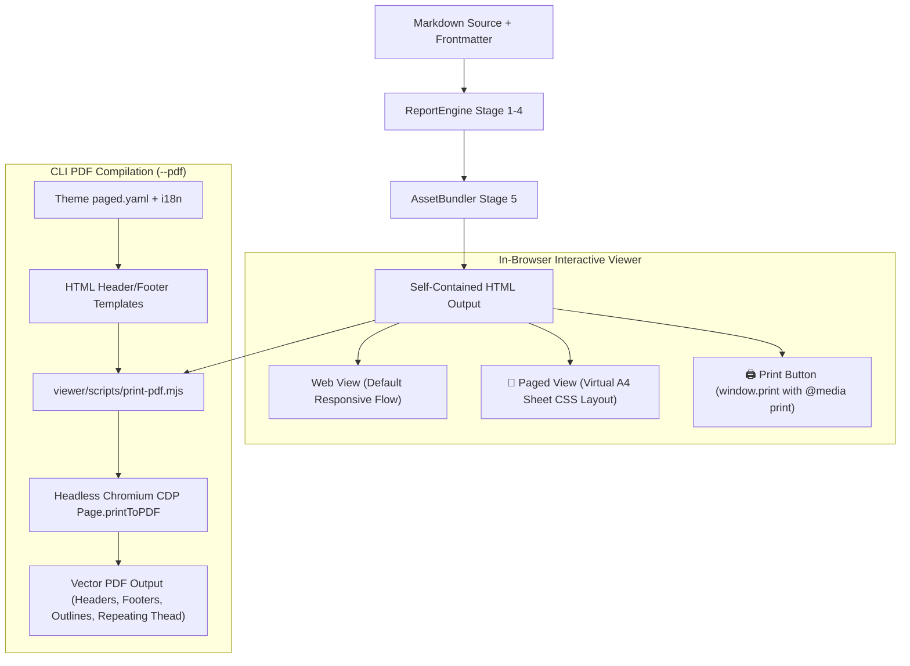

# Implementation Plan: Modern Pagination Architecture

## 1. Executive Summary & Goals

### The Problem
The current pagination system relies on **Paged.js**, a client-side JavaScript polyfill that dynamically parses CSS, chunks and duplicates DOM nodes across synthetic `.pagedjs_pages` containers, and rewrites style ASTs at runtime. While conceptually aiming for CSS Paged Media `@page` standards, in practice this architecture causes severe operational problems:
1. **Fragility & Crashes**: Modern CSS features (e.g. `:has()`, flexbox/grid, custom counters) frequently break Paged.js's querySelectorAll parser, leading to fatal JavaScript exceptions or negative counter offsets (`-3`).
2. **Broken Interactivity**: Duplicating and splitting DOM nodes breaks reactive listeners, search filtering, and the Knowledge Base Inspector drawer on paginated pages.
3. **Flawed PDF Export**: The CLI's headless Chromium `--print-to-pdf` currently ignores CSS `@top-left` / `@bottom-right` margin boxes unless Paged.js has already restructured the document, leading to missing headers, footers, or blank trailing pages.

### The Solution: Native Modern Pagination
This plan transitions `md-style` to a robust, dual-tier modern pagination architecture:
1. **Tier 1: High-Fidelity PDF Generation via Native Chromium CDP (`Page.printToPDF`)**:
   - Bypass Paged.js entirely during PDF generation.
   - Use Chrome DevTools Protocol (CDP) `Page.printToPDF` with native Blink C++ layout:
     - `displayHeaderFooter: true`
     - Dynamic HTML `headerTemplate` and `footerTemplate` interpolated from theme `paged.yaml`, metadata, and i18n catalogs.
     - Native page number classes: `<span class="pageNumber"></span>` and `<span class="totalPages"></span>`.
     - Native table pagination: tables split automatically across pages with clean `thead` repetition and no clipped table rows.
     - Native PDF bookmarks: `generateDocumentOutline: true` automatically creates clickable document outlines / Table of Contents in PDF reader sidebars.
     - Speed: Generates multi-page PDFs in **~200ms - 1.5s**, compared to multi-second JS polyfill runs.
2. **Tier 2: In-Browser Paged Preview & Native Print**:
   - Web view remains an interactive, responsive application with the dark HUD and Inspector drawer intact.
   - When toggling **"📄 Paged View"**, switch to a **Virtual Paper Sheet (`.sheet-a4`)** layout in CSS that frames the document in realistic A4 sheets with margin guides and drop shadows without duplicating or slicing DOM elements.
   - Add a direct **"🖨️ Print / Save PDF"** action in the HUD ribbon that triggers browser-native printing (`window.print()`).
   - Remove or isolate `Paged.js` from the core bundle, cutting `viewer.bundle.js` bundle size and eliminating all DOM parsing crashes.

---

## 2. User Review Required & Design Decisions

> [!IMPORTANT]
> **Decision 1: In-Browser Paged Preview Strategy**
> How should the "📄 Paged View" button behave in the web browser?
> - **Option A (Recommended — Virtual Paper Sheet CSS Mode)**:
>   - The document is styled into continuous realistic A4 pages (`210mm x 297mm`) with margins, paper textures, and page break guides.
>   - **Zero DOM slicing or copying**: all interactive widgets (Search bar, Knowledge Inspector drawer, clickable entity badges, copy buttons) remain 100% reactive and functional.
>   - Completely removes `Paged.js` from `viewer.bundle.js`, dramatically shrinking bundle size and eliminating polyfill errors.
>   - For physical printing or PDF saving from the browser, clicking "🖨️ Print" invokes the native browser print engine with full `@media print` styling.
> - **Option B (Retain Paged.js as Optional Client-Side Polyfill)**:
>   - Keep `Paged.js` strictly as an in-browser previewer when toggled on, but completely decouple it from CLI `--pdf` generation.
>   - *Tradeoff*: DOM elements will be sliced into pages on screen, but event listeners and inspector drawers will remain fragile on sliced pages.

> [!NOTE]
> **Decision 2: CLI PDF Engine Fallback**
> - The primary CDP printer will run via a dedicated lightweight script `viewer/scripts/print-pdf.mjs` (executed via Node.js or Bun, which is already standard in the project for `render-diagram.mjs`).
> - If Node.js / Bun are missing, the engine will gracefully fall back to direct Chromium headless `--print-to-pdf`.

---

## 3. Architecture & Technical Workflow



---

## 4. Proposed Changes by Component

### Component A: PDF Generation & Chromium CDP Bridge

#### [NEW] `viewer/scripts/print-pdf.mjs`
A robust, standalone CDP printer script:
- Launches `/usr/bin/chromium-browser` (or `chromium`, `google-chrome`, `brave-browser`) with `--headless=new`, `--remote-debugging-port=0`, and a temporary clean profile.
- Connects directly to the page's WebSocket debugger target.
- Issues `Page.printToPDF` with:
  ```javascript
  {
    printBackground: true,
    displayHeaderFooter: Boolean(headerHtml || footerHtml),
    headerTemplate: headerHtml || "<div></div>",
    footerTemplate: footerHtml || "<div></div>",
    marginTop: margins.topInches ?? 0.8,
    marginBottom: margins.bottomInches ?? 0.8,
    marginLeft: margins.leftInches ?? 0.6,
    marginRight: margins.rightInches ?? 0.6,
    preferCSSPageSize: true,
    generateTaggedPDF: true,
    generateDocumentOutline: true
  }
  ```
- Writes clean vector PDF to destination path.

#### [MODIFY] `core/engine.py`
- Update `_compile_pdf(self, src_html: Path, dst_pdf: Path)`:
  - Generate dynamic `headerTemplate` and `footerTemplate` HTML strings from the resolved theme's `paged` config, document title, frontmatter metadata, and i18n catalog.
  - Pass templates and margin dimensions to `viewer/scripts/print-pdf.mjs` via Node/Bun runtime.
  - Fall back to standard headless Chromium CLI if Node/Bun is unavailable.

---

### Component B: Theme Header & Footer HTML Template Synthesis

#### [MODIFY] `core/bundler.py`
- Add `build_cdp_header_footer_templates(theme, catalog, title, frontmatter, fingerprint)`:
  - Synthesize clean HTML templates for CDP:
    ```html
    <!-- Header Template -->
    <div style="font-size: 8pt; font-family: 'JetBrains Mono', monospace; color: #64748b; width: 100%; display: flex; justify-content: space-between; padding: 0 15mm; border-bottom: 1px solid #cbd5e1; box-sizing: border-box;">
      <span>{{ left }}</span>
      <span style="font-weight: bold; color: #ef4444;">{{ center }}</span>
      <span>{{ right }}</span>
    </div>
    
    <!-- Footer Template -->
    <div style="font-size: 8pt; font-family: 'JetBrains Mono', monospace; color: #64748b; width: 100%; display: flex; justify-content: space-between; padding: 0 15mm; border-top: 1px solid #cbd5e1; box-sizing: border-box;">
      <span>{{ left }}</span>
      <span>{{ center }}</span>
      <span>Page <span class="pageNumber"></span> of <span class="totalPages"></span></span>
    </div>
    ```
  - Map theme colors (e.g. Cyber cyan `#06b6d4`, Forensic red `#dc2626`, SVJ blue `#2563eb`).

---

### Component C: In-Browser Paged Mode & Virtual Sheet Layout

#### [MODIFY] `styles/base/paged.css`
- Add `.sheet-view` / `.paged-preview` CSS rules:
  - Wrap article or body in realistic A4 paper sheets (`210mm` max width, auto height, page border, paper elevation shadows).
  - Define visible page-break markers (`.page-break-indicator`).
  - Optimize `@media print` rules:
    ```css
    @media print {
      body { background: #fff !important; margin: 0 !important; }
      #md-style-viewer-root, .hud-ribbon, .inspector-drawer { display: none !important; }
      table { break-inside: auto !important; }
      thead { display: table-header-group !important; }
      tr, li, blockquote, .callout { break-inside: avoid !important; }
      h1, h2, h3, h4, h5, h6 { break-after: avoid !important; }
    }
    ```

#### [MODIFY] `viewer/src/HudRibbon.svelte`
- Add a direct **"🖨️ Print"** button next to "📄 Paged View" triggering `window.print()`.
- Update tooltip and keyboard shortcuts (`Ctrl+P`).

#### [MODIFY] `viewer/src/App.svelte`
- If Option A is approved: Replace Paged.js previewer initialization with CSS sheet mode toggle (`document.body.classList.toggle('paged-sheet-view')`).
- If Option B is approved: Keep Paged.js as an isolated on-screen preview toggle while ensuring `--pdf` exclusively uses the CDP bridge.

---

## 5. Verification Plan

### Automated Tests
1. **CDP PDF Generation Test**:
   - `uv run pytest tests/test_paged_theme.py -v`:
   - Verify generated PDF file exists and is valid.
   - Verify PDF contains custom header text, footer text, and page counter strings.
2. **Text & Outline Extraction**:
   - Use `pdftotext` on `output/sample-forensic-cyber.pdf` to verify running headers (e.g. `TLP:RED // RESTRICTED`) and running footers (`Page X of Y`).
3. **Regression Suite**:
   - `uv run pytest` to ensure all 59 tests continue passing.

### Manual Verification
1. Run `make samples` and generate all sample PDFs:
   ```bash
   uv run md-style examples/sample-forensic-cyber.md -s forensic/cyber --pdf -o output/sample-cyber.pdf
   uv run md-style examples/pozvánka-shromáždění-svj.md -s svj/invitation --pdf -o output/sample-svj.pdf
   ```
2. Convert PDF pages to PNG using `pdftoppm`:
   - Inspect page 1, 2, and 3: verify headers, footers, repeating table headers, and clean page breaks.
3. Open `output/sample-forensic-cyber.html` in browser:
   - Verify web view, toggle "📄 Paged View", verify inspector drawer works without errors, test "🖨️ Print" button.
