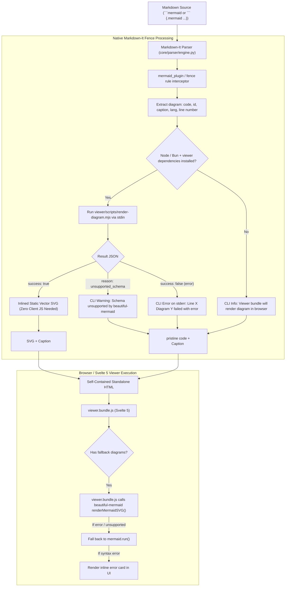

# Implementation Plan: Viewer-Managed Beautiful Mermaid, CLI Diagnostics, Vendor Deletion, and Markdown-It Compliance

## 1. Goal Description

Transition `beautiful-mermaid` from an unmaintained, unmanaged standalone bundle in `vendor/` into a first-class, package-managed dependency inside `viewer/package.json`.

This accomplishes:
1. **Full Package Manager Integration & Vulnerability Auditing**:
   - `beautiful-mermaid` (`^1.1.3`) is formally declared in `viewer/package.json` alongside `mermaid` (`^11.4.1`).
   - Enables standard npm security auditing (`npm audit`), automated dependency upgrades (Dependabot / Renovate), and version tracking (`npm outdated`).
   - Completely removes the untracked, unmaintained `vendor/` directory (`vendor/beautiful-mermaid.bundle.mjs` and orphaned `vendor/paged.polyfill.js`).
2. **Dual-Mode Diagram Pipeline (Build-Time Pre-Rendering + Dynamic Viewer Fallback)**:
   - **Build-Time Pre-Rendering (CLI)**: When Node or Bun is present, Python executes `viewer/scripts/render-diagram.mjs` to pre-render diagrams into beautiful, theme-aware, static vector SVGs (`zinc-light`, `zinc-dark`, custom Inter typography, clean arrows) embedded directly in the standalone HTML.
   - **Dynamic Viewer Fallback**: If Node/Bun is absent or if a diagram schema is unsupported by `beautiful-mermaid` (`gantt`, `mindmap`), `viewer.bundle.js` in the browser renders it dynamically using `beautiful-mermaid` (falling back to standard `mermaid.js`).
3. **Prominent CLI Error & Diagnostic Visibility**:
   - When a diagram contains syntax errors or fails compilation, `render-diagram.mjs` returns the exact syntax error.
   - Python immediately writes an explicit error to `sys.stderr`:
     `[ERROR] Mermaid diagram '#fig-payload-staging' (line 42) failed: Invalid mermaid header ...`
   - Warns on unsupported schemas or missing JS runtimes instead of failing silently.
4. **Fix CommonMark 4-Space Indentation & Entity Mangling Bug**:
   - Move Mermaid diagram handling out of crude pre-pass regex replacements into a native `markdown_it` fence plugin.
   - Tokens are rendered directly to HTML, preventing CommonMark from interpreting 4-space indented lines inside diagrams as indented markdown code blocks (`<pre><code>` and `&amp;gt;` corruption).
5. **Preserve Completed Milestone Items**:
   - Pygments dynamic CSS injection & highlighting.
   - Pandoc marks compliance (`pandoc_divs_plugin`, `attrs_plugin`, `toc_plugin`, `callouts_plugin`).
   - Root `Makefile` (`install`, `install-viewer`, `build-viewer`, `build`, `test`, `samples`, `clean`).

---

## 2. User Review Required

> [!IMPORTANT]
> **Complete Elimination of `vendor/` in Favor of `viewer/package.json`**:
> - `vendor/beautiful-mermaid.bundle.mjs` (3.28 MB) and `vendor/paged.polyfill.js` (921 KB) are **completely deleted**.
> - `beautiful-mermaid` is installed as a managed npm dependency in `viewer/package.json`.
> - Any updates or security advisories will be tracked via `npm audit` and standard package management.
> - Build-time SVG rendering is handled by a small, clean 35-line script `viewer/scripts/render-diagram.mjs` that imports `beautiful-mermaid` from `viewer/node_modules/`.

> [!NOTE]
> **CLI Diagnostic Feedback**:
> - Syntax errors in Mermaid diagrams are no longer silent or buried in browser consoles.
> - The CLI prints line numbers, diagram IDs, and exact error messages to `sys.stderr`.

---

## 3. High-Level Architecture



---

## 4. Proposed Changes

### Component 1: `viewer/` Dependency Management & CLI Runner

#### [MODIFY] `viewer/package.json`
- Add `"beautiful-mermaid": "^1.1.3"`.
- Ensure `"mermaid": "^11.4.1"` is present for schemas unsupported by `beautiful-mermaid`.

#### [NEW] `viewer/scripts/render-diagram.mjs`
- Clean, minimal 35-line ES module:
  ```javascript
  import { renderMermaidSVG } from 'beautiful-mermaid';
  import fs from 'fs';

  function parseArgs() {
    const args = process.argv.slice(2);
    const options = { theme: 'zinc-light', transparent: true, font: 'Inter' };
    for (let i = 0; i < args.length; i++) {
      if (args[i].startsWith('--theme=')) options.theme = args[i].split('=')[1];
      else if (args[i] === '--theme' && args[i + 1]) options.theme = args[++i];
      else if (args[i] === '--transparent') options.transparent = true;
      else if (args[i] === '--no-transparent') options.transparent = false;
    }
    return options;
  }

  try {
    const input = fs.readFileSync(0, 'utf-8').trim();
    if (!input) {
      console.log(JSON.stringify({ success: false, reason: 'empty_input', error: 'Empty diagram content' }));
      process.exit(0);
    }
    const options = parseArgs();
    const svg = renderMermaidSVG(input, options);
    console.log(JSON.stringify({ success: true, svg }));
  } catch (err) {
    const msg = err.message || String(err);
    const isUnsupported = msg.includes('Expected') || msg.includes('not supported') || msg.includes('Invalid mermaid header');
    console.log(JSON.stringify({
      success: false,
      reason: isUnsupported ? 'unsupported_schema' : 'render_error',
      error: msg
    }));
  }
  ```

#### [MODIFY] `viewer/src/App.svelte`
- Import `renderMermaidSVG` from `'beautiful-mermaid'`.
- In `setupMermaidDiagrams()`, inspect diagrams with `.mermaid` inside `.mermaid-fallback`:
  - Attempt rendering with `renderMermaidSVG` matching document theme (`zinc-light` or `zinc-dark`).
  - If unsupported, fall back to `mermaid.run()`.
  - If a syntax error is caught, display an inline diagnostic alert card instead of failing silently or breaking the layout.

#### [DELETE] `vendor/beautiful-mermaid.bundle.mjs`
#### [DELETE] `vendor/paged.polyfill.js`
#### [DELETE] `vendor/` (entire directory deleted)

---

### Component 2: Python Engine & CLI Diagnostics

#### [MODIFY] `core/config.py`
- Remove all references to `vendor/`.
- Define path to viewer script:
  ```python
  VIEWER_DIR = PROJECT_DIR / "viewer"
  MERMAID_SCRIPT = VIEWER_DIR / "scripts" / "render-diagram.mjs"
  ```

#### [MODIFY] `core/diagrams/mermaid.py`
- Implement `BeautifulMermaidRunner`:
  - Locates `bun` or `node`.
  - Checks if `MERMAID_SCRIPT` and `VIEWER_DIR / "node_modules" / "beautiful-mermaid"` exist.
  - Passes diagram source via `stdin`.
  - Maps document theme to beautiful-mermaid theme (`forensic-cyber` $\to$ `zinc-dark`, default $\to$ `zinc-light`).
  - On error:
    ```python
    logger.error(f"[ERROR] Mermaid diagram '{diagram_id}' (line {line_no}) failed: {error_msg}")
    ```
  - Emits `<figure class="mermaid-diagram" data-engine="beautiful-mermaid"{id_attr}>` with static SVG, or `<figure class="mermaid-diagram mermaid-fallback" data-engine="client">` with unindented code on fallback.
  - Localized figure captions via Babel (`Figure 1:`, `Obrázek 1:`).

#### [NEW] `core/parser/plugins/mermaid_plugin.py`
- Markdown-It plugin registering a fence interceptor:
  - Captures `fence` tokens where info starts with `mermaid` or `{.mermaid`.
  - Extracts `#id` and `caption="..."`.
  - Invokes `BeautifulMermaidRunner`.
  - Returns raw HTML string (bypassing CommonMark 4-space code block injection).

#### [MODIFY] `core/parser/engine.py`
- Enable `mermaid_plugin` in `MarkdownParser`.
- Remove pre-pass regex replacement from `core/engine.py` so diagrams are processed cleanly through the token stream.

---

### Component 3: Makefile & Developer Automation

#### [MODIFY] `Makefile`
- Update `install-viewer`: `cd viewer && npm install`
- Update `build-viewer`: `cd viewer && npm run build`
- Ensure `test` and `samples` run cleanly.

---

## 5. Verification Plan

### Automated Tests
1. `uv run pytest tests/` — verify all tests pass.
2. `make build-viewer` — verify Vite compiles `viewer.bundle.js` with `beautiful-mermaid`.
3. Test CLI error reporting:
   - Run `uv run md-style` with a markdown file containing invalid Mermaid syntax (`flowchart TD; broken :::`).
   - Verify that `[ERROR] Mermaid diagram ... failed:` is printed to `sys.stderr`.
4. Compile `examples/sample-forensic-report.md`:
   - Verify both Diagram 1 (`flowchart TD`) and Diagram 2 (`sequenceDiagram`) are compiled into full static `<svg>` elements.
   - Inspect output HTML to verify zero `<pre><code>` inside diagrams.
   - Check file output: `output/sample-forensic-report.html`.
5. Run `make samples` to compile all sample reports.

### Manual Verification
- Open `output/sample-forensic-report.html` in browser:
  - Diagram 1 (Attacker Intrusion Kill-Chain) renders as vector SVG.
  - Diagram 2 (Execution and Staging Sequence) renders as vector SVG.
  - No syntax errors in browser console.
  - Interactive inspector drawer and table search work smoothly.
