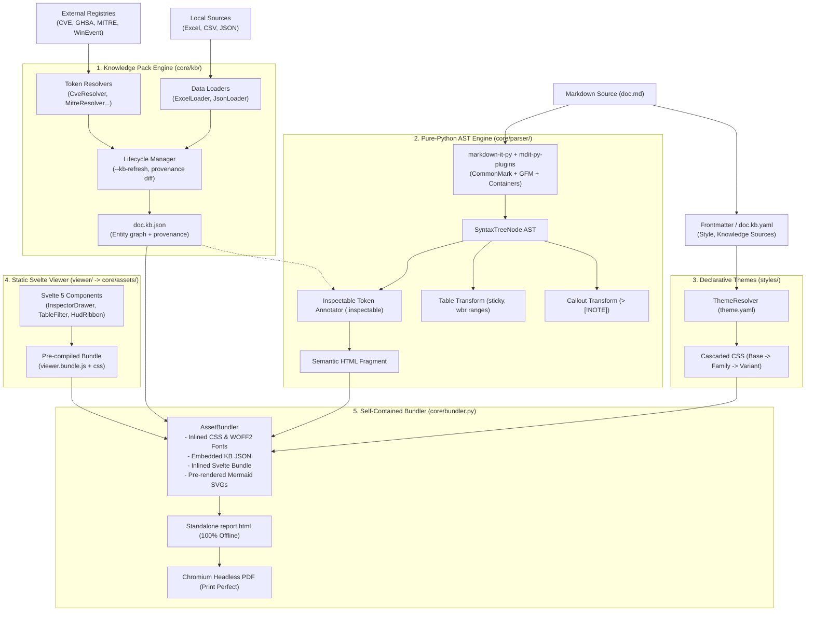

# Implementation Plan: Pure-Python Engine, Knowledge Packs & Svelte Redesign (v3.0)

---

## Goal Description

Modernize and decouple `md-style` from an external Pandoc/Lua pipeline into a modular, pure-Python architecture with:
1. **Pure-Python Markdown AST Engine (`markdown-it-py` + `mdit-py-plugins`)**: Eliminates the external Haskell `pandoc` binary dependency and fragile Lua filters. Unlocks sub-50ms builds, typed AST transforms, GFM tables, GitHub callouts, and clean token tagging.
2. **Modular Knowledge Packs (`.kb.json`) & Multi-Source Lifecycle**: Decoupled ingestion architecture separating local data loaders (Excel `.xlsx`, CSV, JSON catalog, CMDB) from registry resolvers (CVE, GHSA, MITRE ATT&CK, Windows Event IDs, statutes). Includes full bundle lifecycle management (`--kb-refresh`, `--kb-refresh=sources`, `--kb-refresh=force`) with provenance hashes and analyst manual override protection.
3. **Declarative Theme Inheritance (`theme.yaml`)**: Structured directory hierarchy replacing flat CSS files and backward symlinks with recursive `extends:` cascading for CSS variables, fonts, and stylesheets.
4. **Static Svelte Interactive Viewer**: Replaces 1,390+ lines of imperative vanilla JavaScript DOM mutations with pre-compiled, reactive Svelte 5 components (`InspectorDrawer.svelte`, `TableFilter.svelte`, `HudRibbon.svelte`), inlined directly into the self-contained output.
5. **100% Self-Contained Output & Chromium PDF Export**: An `AssetBundler` inlines all CSS, base64 WOFF2 fonts, images, KB data, and viewer bundle into a standalone offline HTML file, with pixel-perfect headless Chromium PDF generation.

---

## User Review Required

> [!IMPORTANT]
> **Key Architecture Decisions for Review & Approval**:
>
> 1. **Zero Node.js Runtime Requirement for End Users**:
>    - The Svelte interactive viewer will be developed in `viewer/` (Vite + Svelte 5) and built into `core/assets/viewer.bundle.js` and `core/assets/viewer.bundle.css`.
>    - These built assets will be tracked in git and bundled with the Python package.
>    - **Result**: Python end-users (`pip install md-style` or `uv run md-style`) require **zero Node.js or npm** on their systems; Node is strictly an opt-in developer dependency for UI component development.
>
> 2. **Clean Break vs Transitional Fallback**:
>    - We propose a clean cutover to pure-Python (`markdown-it-py`). `pandoc` process calls and Lua filter files (`callouts.lua`, `table-nowrap.lua`, `forensic.lua`, `forensic-cyber.lua`) will be deprecated and removed once parity tests pass.
>    - This immediately eliminates the #1 source of installation failures and cross-platform issues.
>
> 3. **KB Refresh Semantics**:
>    - `md-style doc.md`: Air-gapped, zero-network, instant build using local `doc.kb.json`.
>    - `md-style doc.md --kb-refresh`: Incremental lookup for new tokens + re-reads modified Excel/JSON sources.
>    - `md-style doc.md --kb-refresh=sources`: Re-reads local Excel/JSON sheets with 0 network calls.
>    - `md-style doc.md --kb-refresh=force`: Bypasses caches and queries external APIs for latest advisories.
>    - Analyst edits flagged with `"manual_override": true` in `doc.kb.json` are strictly preserved across refreshes.

---

## Open Questions & Clarifications

> [!NOTE]
> Please review the following points and confirm your preferences:
> 1. **Code Block Highlighting**:
>    - We plan to use **Pygments** (Python native) configured with pygments themes matching the document style (e.g. `monokai`/`dracula` for cyber, `default`/`friendly` for classic forensic). Is Pygments acceptable, or do you have specific CSS tokenization preferences?
> 2. **Frontmatter vs Sidecar for KB Sources**:
>    - Both inline frontmatter (`knowledge: sources: [...]`) and sidecar file (`doc.kb.yaml`) will be supported. When both exist, sidecar takes precedence or merges with frontmatter. Does this match your workflow?
> 3. **Excel Engine Dependency**:
>    - We will use `openpyxl` as an optional/core dependency for reading `.xlsx` files. Is `openpyxl` acceptable?

---

## Architecture Overview



---

## Proposed Changes

Grouped by component layer and ordered by dependency order:

### 1. Project Dependencies & Configuration

#### [MODIFY] `pyproject.toml`
Add pure-Python parsing, syntax highlighting, and Excel data reading dependencies:
```toml
[project]
name = "md-style"
version = "3.0.0"
description = "Modern pure-Python Markdown report generator with Knowledge Packs, declarative themes, and Svelte viewer"
readme = "README.md"
requires-python = ">=3.9"
dependencies = [
    "babel>=2.14.0",
    "pyyaml>=6.0.3",
    "markdown-it-py>=3.0.0",
    "mdit-py-plugins>=0.4.0",
    "pygments>=2.17.0",
    "jinja2>=3.1.0",
    "openpyxl>=3.1.5",
]

[project.scripts]
md-to-report = "core.cli:main"
md-style = "core.cli:main"
```

---

### 2. Knowledge Pack Ingestion & Lifecycle Engine (`core/kb/`)

Decouple monolithic enrichers into clean loaders, resolvers, and lifecycle management.

#### [NEW] `core/kb/models.py`
Type definitions and Pydantic/dataclass schema for knowledge entities, provenance, and source digests:
- `Entity`: `id`, `domain`, `type`, `label`, `title`, `severity`, `badge`, `summary`, `attributes`, `references`, `provenance`.
- `Provenance`: `source`, `fetched_at`, `status`, `manual_override`.
- `KnowledgePack`: `version`, `document_id`, `generated_at`, `sources_digest`, `entities`.

#### [NEW] `core/kb/loaders/base.py` & `core/kb/loaders/excel_loader.py` & `core/kb/loaders/json_loader.py`
- `BaseDataLoader`: Abstract interface for reading tabular/structured assets.
- `ExcelLoader`: Reads `.xlsx` using `openpyxl`, extracts rows into entity definitions using column mappings configured in YAML.
- `JsonCatalogLoader`: Reads network topology, CMDB inventories, or custom asset dumps.

#### [NEW] `core/kb/resolvers/base.py` & modular resolvers:
- `CveResolver`: CIRCL / NVD lookup with local caching and CVSS calculations.
- `GhsaResolver`: GitHub Advisory resolver.
- `MitreResolver`: MITRE ATT&CK technique IDs (e.g. `T1003.001` -> OS Credential Dumping: LSASS Memory).
- `WinEventResolver`: Windows Security Event IDs catalog (e.g. `4624`, `4625`, `4720`, `1102`).
- `StatuteResolver`: Legal paragraph and section references.

#### [NEW] `core/kb/lifecycle.py`
Knowledge pack coordinator handling `--kb-refresh`:
- Compares sources file hashes (`sources_digest`).
- Preserves entries where `manual_override: true`.
- Three execution modes:
  - `incremental`: Only resolves new tokens or modified source files.
  - `sources`: Re-reads local files without hitting internet APIs.
  - `force`: Bypasses caches and queries all external endpoints.
- Auto-saves updated `report.kb.json`.

---

### 3. Declarative Theme System (`styles/` and `core/themes.py`)

#### [NEW] `core/themes.py`
Theme resolution engine:
- Traverses theme hierarchy via `theme.yaml`.
- Handles `extends: base` or `extends: forensic/dossier`.
- Cascades CSS files in correct inheritance order.
- Generates CSS variable blocks from theme definitions.

#### [RESTRUCTURE] `styles/`
Migrate flat CSS and remove symlinks into a clean inheritance hierarchy:
```
styles/
├── base/
│   ├── theme.yaml
│   ├── reset.css
│   ├── tokens.css
│   ├── typography.css
│   ├── tables.css
│   └── print.css
├── forensic/
│   ├── dossier/
│   │   ├── theme.yaml
│   │   └── forensic.css
│   └── cyber/
│       ├── theme.yaml
│       └── cyber.css
├── svj/
│   ├── base/
│   │   ├── theme.yaml
│   │   └── svj-base.css
│   ├── invitation/
│   │   ├── theme.yaml
│   │   └── invitation.css
│   ├── ballot/
│   │   ├── theme.yaml
│   │   └── ballot.css
│   └── community/
│       ├── theme.yaml
│       └── community.css
└── general/
    ├── school/
    │   └── theme.yaml
    └── announcement/
        └── theme.yaml
```

Example `styles/forensic/cyber/theme.yaml`:
```yaml
name: forensic/cyber
title: "Forensic Cyber Dark Dossier"
extends: forensic/dossier
stylesheets:
  - cyber.css
features:
  interactive_viewer: true
  sticky_tables: true
  break_ranges: true
variables:
  --bg-primary: "#070b12"
  --text-main: "#e2e8f0"
  --accent-cyan: "#06b6d4"
```

---

### 4. Pure-Python Markdown AST Engine (`core/parser/`)

#### [NEW] `core/parser/engine.py`
Configures `markdown-it-py` with plugins:
- Frontmatter parsing (`mdit_py_plugins.front_matter`)
- GitHub-style tasklists (`mdit_py_plugins.tasklists`)
- Generic containers (`mdit_py_plugins.container` for `::: note`, `::: timeline`)
- Syntax highlighting via Pygments integration for code blocks
- Table parsing with cell alignment support

#### [NEW] `core/parser/transforms/callouts.py`
Replaces `filters/callouts.lua`:
- Detects blockquotes starting with `[!NOTE]`, `[!TIP]`, `[!IMPORTANT]`, `[!WARNING]`, `[!CAUTION]`.
- Transforms them into `<div class="callout callout-note">` with matching SVG icons and accessible labels.

#### [NEW] `core/parser/transforms/tables.py`
Replaces `filters/table-nowrap.lua`:
- Wraps all `<table>` elements in `<div class="table-wrapper">`.
- Inspects table cells for datetime/timestamp ranges (e.g. `2026-09-29 10:00:00 - 2026-09-29 12:00:00`) and inserts `<wbr>` break opportunities without breaking whitespace.
- Identifies numeric columns and applies `.num` right-alignment classes.

#### [NEW] `core/parser/transforms/entities.py`
Replaces `styles/forensic.lua` and `styles/forensic-cyber.lua`:
- Walks text nodes and identifies tokens matching active Knowledge Pack entities (CVEs, MITRE, WinEvent IDs, IP addresses, hashes, customer hostnames).
- Replaces matches with `<span class="inspectable" data-type="..." data-token="...">...</span>`.
- Bypasses text already inside links, code blocks, or HTML tags.

---

### 5. Static Svelte 5 Interactive Viewer (`viewer/`)

#### [NEW] `viewer/package.json`, `viewer/vite.config.ts`, `viewer/src/`
Lightweight Svelte 5 project compiled to `core/assets/viewer.bundle.js` and `core/assets/viewer.bundle.css`.
- `src/InspectorDrawer.svelte`: Slide-out sidebar displaying entity details, CVSS scores, remediation links, or internal asset metadata when `.inspectable` is clicked.
- `src/TableToolbar.svelte`: Reactive search filtering and category chips for data tables.
- `src/HudRibbon.svelte`: Sticky reading progress bar, table of contents drawer toggle, and quick print/export action buttons.
- `src/main.ts`: Initializes the application on document load and mounts to `#md-style-viewer-root`. Automatically handles desktop vs mobile viewport and hides completely in `@media print`.

---

### 6. Asset Bundler & Output Generation (`core/bundler.py`)

#### [NEW] `core/bundler.py`
Replaces Pandoc's `--embed-resources`:
- Inlines cascaded stylesheets into `<style>` blocks.
- Converts local fonts (WOFF2/TTF) and images into base64 data URIs.
- Injects Knowledge Pack JSON into `<script id="md-style-kb" type="application/json">`.
- Injects pre-compiled Svelte viewer code (`viewer.bundle.js`) into `<script>`.
- Generates 100% self-contained single-file HTML.

#### [MODIFY] `core/engine.py` & `core/cli.py`
- Rewire pipeline to run: `Knowledge Lifecycle` -> `Theme Resolution` -> `Markdown-It AST Parsing & Transforms` -> `Asset Bundling` -> `PDF Generation (Chromium headless)`.
- Add CLI commands:
  - `md-style doc.md` (default instant build)
  - `md-style doc.md --kb-refresh[=mode]`
  - `md-style kb status doc.md`
  - `md-style kb export doc.md`

#### [DELETE] Deprecate & Remove Legacy Pandoc / Lua Artifacts
- Remove `filters/callouts.lua`, `filters/table-nowrap.lua`, `styles/forensic.lua`, `styles/forensic-cyber.lua`.
- Remove `templates/forensic-cyber-interactive.html` (replaced by Svelte viewer).

---

## Verification Plan

### Automated Tests
1. **Knowledge Pack & Refresh Tests**:
   - `tests/test_kb_lifecycle.py`: Verify incremental refresh, sources-only refresh, and manual override preservation.
   - `tests/test_loaders.py`: Test Excel and JSON ingestion with mock network inventories.
2. **Parser & AST Transform Tests**:
   - `tests/test_parser_gfm.py`: Verify GFM tables, tasklists, and code block highlighting.
   - `tests/test_transforms.py`: Verify callout blockquote transformation, table `<wbr>` injection, and `.inspectable` token tagging.
3. **Theme Inheritance Tests**:
   - `tests/test_themes.py`: Verify `extends:` resolution, variable overrides, and stylesheet cascading order.
4. **Self-Contained Bundler Tests**:
   - `tests/test_bundler.py`: Verify output HTML has zero external network requests and embeds base64 assets cleanly.

### Manual & Visual Verification
1. **Render Real Report**:
   - Build `forenzní-analýza-bv-ad.md` using the new pipeline:
     `uv run md-style forenzní-analýza-bv-ad.md -s forensic/cyber -o output/bv-v3.html`
2. **Headless Chromium CDP Checks**:
   - Verify sticky table headers remain locked during vertical scroll.
   - Verify clicking `.inspectable` opens the Svelte `InspectorDrawer`.
   - Verify table filter search reactively filters rows.
3. **Print & `--paged` Verification**:
   - Verify `@media print` renders clean white paper pages without interactive HUDs or drawer DOM.
