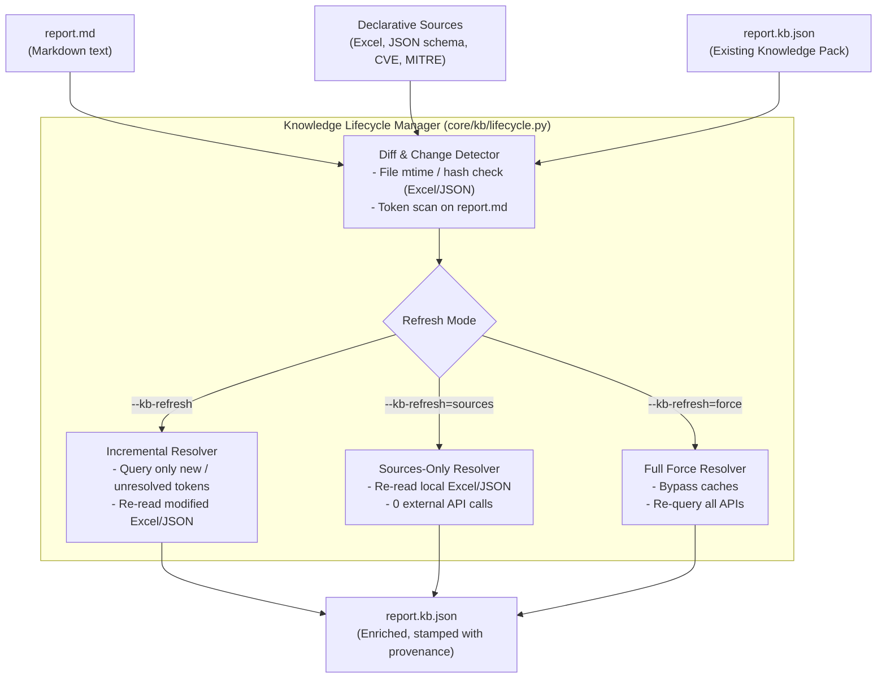

# Implementation Plan: Pure-Python Engine, Declarative Theme Inheritance, Svelte Viewer, Modular Knowledge Plugins & KB Refresh Lifecycle

---

## 1. Goal Description

This blueprint details the architectural decoupling and modernization of `md-style` into version 3.0:
1. **Pure-Python Parsing & AST Manipulation**:
   - Replace the external Haskell binary (`pandoc`) and fragmented Lua filters with **`markdown-it-py`** + **`mdit-py-plugins`**.
   - Implement fluid table formatting, breakable timestamp ranges (`<wbr>`), and inspectable entity spans in typed, testable Python AST walkers (`SyntaxTreeNode`).
2. **Declarative Theme Architecture & Inheritance (`theme.yaml`)**:
   - Standardize all styles into a clean, hierarchical theme tree with `theme.yaml` files supporting `extends: ...`.
   - Enable clean CSS custom property overrides and composable stylesheet cascading across style families (`forensic`, `svj`, `corporate`, `legal`).
3. **Modular Knowledge Plugins & Multi-Source Ingestion**:
   - Decouple entity resolution into fine-grained, single-purpose plugins:
     - **External Registries**: CVE (CIRCL/NVD), GHSA (GitHub Advisories), MITRE ATT&CK, Windows Event IDs.
     - **Internal Enterprise Sources**: Excel sheets (`.xlsx`), CSV files, JSON network schemas, and CMDB inventory dumps.
     - **Legal & Compliance**: Statutes and paragraph citations.
4. **Knowledge Pack Lifecycle & Bundle Refresh (`--kb-refresh`)**:
   - Add explicit lifecycle controls: build, inspect, and refresh knowledge bundles.
   - Support incremental refreshes (only missing/unresolved entities), sources-only refreshes (local Excel/JSON re-reads), and full forced refreshes with entity provenance tracking.
5. **Svelte-Powered Static Interactive Viewer**:
   - Replace 1,390+ lines of brittle, manual vanilla JavaScript DOM mutations with modular **Svelte components** (`InspectorDrawer.svelte`, `TableFilter.svelte`, `HudRibbon.svelte`).
   - Svelte compiles ahead-of-time (via Vite) into a minified, zero-runtime-overhead static bundle (`viewer.bundle.js`).
6. **100% Self-Contained Output**:
   - An `AssetBundler` inlines all CSS, base64 WOFF2 fonts, images, compiled Svelte viewer code, and Knowledge Pack JSON into a single offline HTML file.

---

## 2. User Review Required

> [!IMPORTANT]
> **Key Architectural Decisions for Approval**:
> 1. **Complete Removal of Pandoc & Lua**: The project will no longer require `pandoc` installed on the host OS. Build speeds will improve by 100x (<50ms vs ~10s).
> 2. **KB Bundle Refresh Modes (`--kb-refresh`)**:
>    - **Default Build (`md-style doc.md`)**: Instant & air-gapped; uses existing `doc.kb.json`.
>    - **Incremental Refresh (`--kb-refresh`)**: Re-reads local Excel/JSON files and only queries external APIs for newly added or unresolved tokens.
>    - **Sources-Only Refresh (`--kb-refresh=sources`)**: Re-reads customer Excel/JSON schemas without hitting any internet APIs.
>    - **Force Refresh (`--kb-refresh=force`)**: Purges cache and re-queries all external registries.
> 3. **Declarative Sources Placement**: Supported both inside document YAML frontmatter and as a dedicated sidecar `doc.kb.yaml`.
> 4. **Svelte 5 Static Build**: Interactive overlays compile to a single zero-runtime bundle (`viewer.bundle.js`).

---

## 3. Knowledge Pack Lifecycle & Bundle Refresh



### Refresh CLI Commands

```bash
# 1. Standard build: Uses existing report.kb.json (0ms network delay, air-gapped)
md-style report.md -s forensic-cyber -o report.html

# 2. Incremental refresh: Resolves new tokens or re-reads modified Excel sheets
md-style report.md --kb-refresh

# 3. Sources-only refresh: Re-reads customer Excel/JSON without touching internet APIs
md-style report.md --kb-refresh=sources

# 4. Force refresh: Re-queries CIRCL/NVD/GHSA for latest CVSS/remediation data
md-style report.md --kb-refresh=force

# 5. Dedicated KB management CLI
md-style kb status report.md     # Shows resolved, unresolved, and source file stats
md-style kb export report.md     # Extracts candidate tokens to report.kb.json
```

---

## 4. Entity Provenance & Knowledge Schema (`kb-schema-v1.json`)

To support reliable refreshes without clobbering manual edits, each entity carries provenance metadata:

```json
{
  "version": "1.0",
  "document_id": "FOR-2026-0929",
  "generated_at": "2026-10-04T09:40:00Z",
  "sources_digest": {
    "customer_assets.xlsx": "sha256:4a8b1c...",
    "network_topology.json": "sha256:9f2d4e..."
  },
  "entities": {
    "cve:CVE-2024-21413": {
      "id": "CVE-2024-21413",
      "domain": "cyber",
      "type": "cve",
      "label": "CVE-2024-21413",
      "title": "Microsoft Outlook Remote Code Execution Vulnerability",
      "severity": "CRITICAL",
      "badge": "CVSS 9.8",
      "summary": "Improper limitation of pathname to restricted directory allows remote code execution.",
      "attributes": {
        "cvss": 9.8,
        "cwe": "CWE-22"
      },
      "references": [
        { "title": "NVD Entry", "url": "https://nvd.nist.gov/vuln/detail/CVE-2024-21413" }
      ],
      "provenance": {
        "source": "cve:circl",
        "fetched_at": "2026-10-04T09:20:00Z",
        "status": "resolved",
        "manual_override": false
      }
    },
    "asset:BOR-AD": {
      "id": "BOR-AD",
      "domain": "internal",
      "type": "asset",
      "label": "BOR-AD",
      "title": "Primary Domain Controller (LanmanNT)",
      "severity": "HIGH",
      "badge": "Tier-0 Asset",
      "summary": "Central domain controller for bezvad.mistni.",
      "attributes": {
        "IP Address": "192.168.45.253/24",
        "Role": "Primary DC",
        "OS": "Windows Server 2022 Build 20348"
      },
      "provenance": {
        "source": "excel:customer_assets.xlsx",
        "sheet": "Server_List",
        "row": 14,
        "fetched_at": "2026-10-04T09:35:00Z",
        "status": "resolved",
        "manual_override": false
      }
    }
  }
}
```

### Smart Merging & Manual Overrides
If an analyst edits `report.kb.json` manually (e.g. setting `"manual_override": true` or adding custom notes), subsequent `--kb-refresh` runs **preserve the manual edits** while updating only non-overridden or newly discovered tokens.

---

## 5. Declarative Source Structure Options

Where should knowledge sources be declared? We support two clean options:

### Option A: In Document Frontmatter (Self-Contained in Markdown)
```yaml
---
title: "Forenzní analýza BOR-AD"
style: forensic/cyber
knowledge:
  sources:
    - type: excel
      path: ./data/customer_assets.xlsx
      sheet: "Servers"
      id_column: "Hostname"
      ip_column: "IP"
      role_column: "Role"
  resolvers:
    - cve
    - ghsa
    - mitre
    - winevent
---
```

### Option B: Standalone Sidecar File (`report.kb.yaml`)
For complex corporate audits or re-usable investigation templates:
```yaml
# report.kb.yaml
document_id: "FOR-2026-0929"
knowledge:
  sources:
    - type: excel
      path: ./customer_network_inventory.xlsx
      sheet: "Production_Hosts"
      id_column: "Hostname"
      ip_column: "Primary_IP"
      role_column: "Function"
    - type: json_catalog
      path: ./network_topology.json
  resolvers:
    - cve
    - mitre
    - winevent
```

*Resolution Hierarchy*:
1. Document Frontmatter (`report.md`)
2. Sidecar File (`report.kb.yaml`)
3. Workspace Default (`.md-style/kb.yaml`)

---

## 6. Theme Configuration & Inheritance (`theme.yaml`)

### Directory Tree Restructuring
Eliminates all flat CSS files and backward symlinks:
```
styles/
├── base/
│   ├── theme.yaml
│   ├── reset.css
│   ├── tokens.css
│   ├── tables.css
│   └── print.css
├── forensic/
│   ├── dossier/
│   │   ├── theme.yaml
│   │   └── forensic.css
│   └── cyber/
│       ├── theme.yaml
│       └── cyber.css
├── svj/
│   ├── base/
│   │   ├── theme.yaml
│   │   └── svj-base.css
│   ├── invitation/
│   │   ├── theme.yaml
│   │   └── invitation.css
│   ├── ballot/
│   │   ├── theme.yaml
│   │   └── ballot.css
│   └── community/
│       ├── theme.yaml
│       └── community.css
└── general/
    ├── school/
    │   └── theme.yaml
    └── announcement/
        └── theme.yaml
```

---

## 7. Svelte Interactive Viewer (`viewer/`)

### Declarative Components
- `InspectorDrawer.svelte`: Slide-out entity drawer showing CVEs, MITRE techniques, legal statutes, or customer asset details.
- `TableToolbar.svelte`: Reactive search input and category pills.
- `HudRibbon.svelte`: Sticky document header ribbon with TOC and reading progress.

Compiled via Vite into `viewer.bundle.js` and inlined into HTML by the `AssetBundler`. Suppressed completely in print mode.

---

## 8. Migration & Rollout Plan

### Phase 1: Modular Knowledge Ingestion & Refresh Engine
1. Implement `BaseDataLoader` and `BaseResolver` in `core/kb/`.
2. Implement `ExcelInventoryLoader` and `JsonCatalogLoader`.
3. Implement `LifecycleManager` supporting `--kb-refresh` (`incremental`, `sources`, `force`).
4. Add CLI commands: `md-style kb refresh <doc.md>`, `md-style kb status <doc.md>`.

### Phase 2: Theme Structure & `theme.yaml`
1. Create `core/themes.py` with `ThemeResolver` supporting recursive `extends:`.
2. Restructure `styles/` into clean hierarchical directories: `styles/base/`, `styles/forensic/dossier/`, `styles/forensic/cyber/`, `styles/svj/base/`.
3. Eliminate all backward symlinks.

### Phase 3: Svelte Universal Viewer
1. Initialize `viewer/` with Svelte 5 and Vite.
2. Build `InspectorDrawer.svelte`, `HudRibbon.svelte`, and `TableToolbar.svelte`.
3. Compile ahead-of-time to `viewer.bundle.js` and integrate into the asset bundler.

### Phase 4: Pure-Python Markdown Parser (`markdown-it-py`)
1. Implement `core/parser.py` using `markdown-it-py` and `mdit-py-plugins`.
2. Implement `core/ast/transforms.py` for fluid tables, breakable timestamp ranges, and entity tagging.
3. Implement `core/bundler.py` for base64 font/image inlining.
4. Verify visual and layout parity with `forenzní-analýza-bv-ad.md`.

### Phase 5: Deprecate Pandoc and Lua
1. Remove `pandoc` process invocation from `core/engine.py`.
2. Delete Lua filter files (`filters/callouts.lua`, `filters/table-nowrap.lua`, `styles/forensic.lua`, `styles/forensic-cyber.lua`).
3. Delete legacy monolithic HTML templates (`templates/forensic-cyber-interactive.html`).

---

## 9. Verification Plan

### Automated Test Suite
- `tests/test_kb_refresh.py`: Test incremental refresh, sources-only refresh, and manual override preservation.
- `tests/test_loaders.py`: Test Excel/CSV and JSON data loaders with sample network schemas.
- `tests/test_parser.py`: Verify CommonMark + GFM tables, tasklists, and container parsing.
- `tests/test_themes.py`: Verify recursive `extends:` cascading for variables and stylesheets.
- `tests/test_bundler.py`: Verify 100% self-contained output (zero external network requests).

### Headless Chromium CDP Verification
- **Pixel & Layout Parity**: Compare rendered pages of `forenzní-analýza-bv-ad.md` against baseline screenshots.
- **Sticky Table Headers**: Verify `thead th` locks at exact HUD offsets during vertical scroll.
- **Svelte Viewer Interactivity**: Verify clicking `.inspectable` spans (including Excel-derived hostnames and CVEs) opens the Svelte drawer and search filters update table rows reactively.
