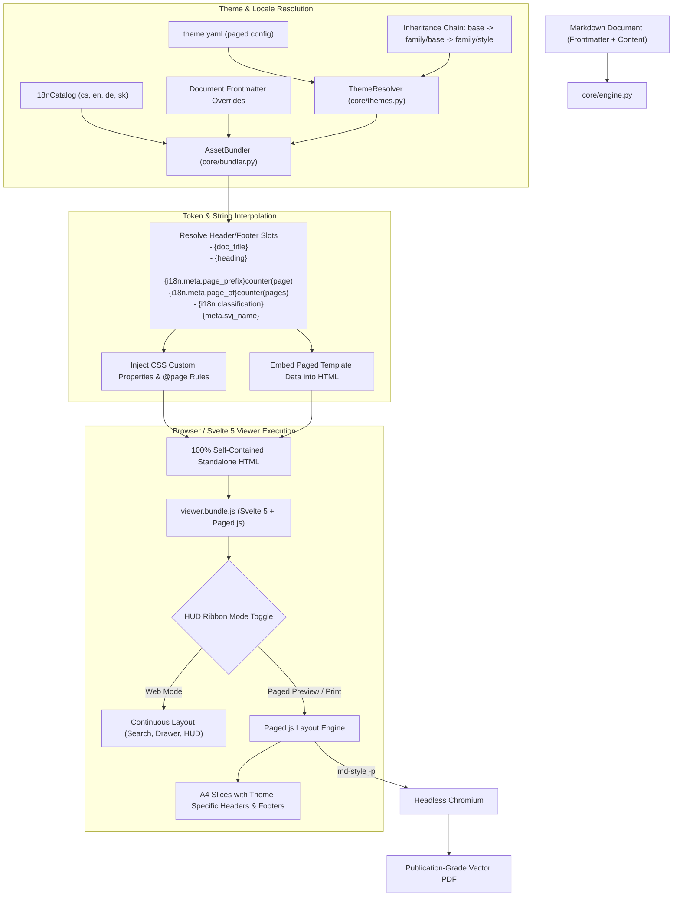

# Implementation Plan: Theme-Driven Paged Media, Headers, Footers & Multilingual Layout

## 1. Goal Description

Enable themes/styles to declaratively specify, customize, and style running headers, footers, page margins, and page counters in paged outputs (both interactive browser print preview and Headless Chromium vector PDF exports).

Different document domains have drastically different requirements:
- **Forensic / Incident Response Reports (`forensic/cyber`, `forensic/dossier`)**:
  - Security classification banners (`TLP:AMBER // CONFIDENTIAL`, localized to `DŮVĚRNÉ`, `VERTRAULICH`).
  - Running chapter/section titles (`string(heading)`).
  - Chain-of-custody metadata, case identifier, and SHA-256 integrity hash.
  - Monospaced typography with technical borders.
- **Housing Association / Legal Documents (`svj/invitation`, `svj/ballot`, `svj/community`)**:
  - Formal corporate heading with entity name, IČO, and assembly date.
  - Legal statute notice (e.g. `Dle § 1207 občanského zákoníku č. 89/2012 Sb.`).
  - Ballot voting pagination and formal committee signatures.
  - Clean, compact typographic rules with subtle dividing lines.
- **Universal Multilingual Support (i18n)**:
  - Dynamic page counter strings matching document locale:
    - English: `Page 3 of 12`
    - Czech: `Strana 3 z 12`
    - German: `Seite 3 von 12`
    - Slovak: `Strana 3 z 12`

---

## 2. User Review Required

> [!IMPORTANT]
> **Declarative `paged` Block in `theme.yaml`**:
> Themes can now declare a `paged` configuration block in `theme.yaml`. Like `variables` and `features`, this block **cascades through the inheritance chain** (`base` $\to$ `svj/base` $\to$ `svj/invitation`).
> Document authors can also override any slot via YAML frontmatter in the Markdown file.

> [!NOTE]
> **Dual-Mode Svelte Viewer (Web View vs. Paged Print Preview)**:
> In the Svelte viewer, users can toggle between:
> 1. **Web Reading Mode (Default)**: Responsive continuous scrolling, sticky HUD ribbon, collapsible inspector drawer, and interactive table filters.
> 2. **Paged Print Preview**: Real A4 pages with margins, page breaks, running headers, footers, and page numbers.
> When printing (`Ctrl + P`) or exporting to PDF via `md-style -p`, Paged mode is automatically engaged.

---

## 3. High-Level Architecture



---

## 4. Proposed Design & Changes

### Component 1: Declarative Theme Configuration (`theme.yaml`)

#### Base Theme Defaults ([`styles/base/theme.yaml`](file:///home/valor/Devel/personal/md-style/styles/base/theme.yaml)):
```yaml
name: base
title: "Universal Base Theme"
paged:
  size: A4
  orientation: portrait
  margins:
    top: 22mm
    right: 18mm
    bottom: 22mm
    left: 18mm
  headers:
    left: "{doc_title}"
    center: ""
    right: "string(heading)"
  footers:
    left: "{date}"
    center: ""
    right: "{i18n.meta.page_prefix}counter(page){i18n.meta.page_of}counter(pages)"
  first_page:
    show_header: false
    show_footer: true
```

#### Forensic Cyber Theme ([`styles/forensic/cyber/theme.yaml`](file:///home/valor/Devel/personal/md-style/styles/forensic/cyber/theme.yaml)):
```yaml
name: forensic/cyber
extends: forensic/dossier
paged:
  margins:
    top: 25mm
    bottom: 25mm
  headers:
    left: "{doc_title}"
    center: "{i18n.meta.confidential_label} // {meta.classification|TLP:AMBER}"
    right: "string(heading)"
  footers:
    left: "{i18n.meta.report_type}"
    center: "SHA-256: {fingerprint_short}"
    right: "{i18n.meta.page_prefix}counter(page){i18n.meta.page_of}counter(pages)"
```

#### SVJ Invitation Theme ([`styles/svj/invitation/theme.yaml`](file:///home/valor/Devel/personal/md-style/styles/svj/invitation/theme.yaml)):
```yaml
name: svj/invitation
extends: svj/base
paged:
  margins:
    top: 20mm
    right: 15mm
    bottom: 20mm
    left: 15mm
  headers:
    left: "{meta.svj_name|doc_title}"
    center: "{i18n.svj.assembly_invite}"
    right: "{meta.assembly_date}"
  footers:
    left: "{i18n.svj.committee_label}"
    center: "{i18n.svj.statute_notice}"
    right: "{i18n.meta.page_prefix}counter(page){i18n.meta.page_of}counter(pages)"
```

---

### Component 2: Multilingual Dictionary Additions (`core/i18n/`)

Extend JSON translation files with domain-specific metadata tokens:
- **`core/i18n/cs.json`**:
  ```json
  "svj": {
    "assembly_invite": "POZVÁNKA NA SHROMÁŽDĚNÍ",
    "ballot_title": "HLASOVACÍ LÍSTEK (PER ROLLAM)",
    "committee_label": "Statutární orgán / Výbor SVJ",
    "statute_notice": "Dle § 1207 z. č. 89/2012 Sb. (NOZ)"
  }
  ```
- **`core/i18n/en.json`**:
  ```json
  "svj": {
    "assembly_invite": "ASSEMBLY INVITATION",
    "ballot_title": "BALLOT VOTE",
    "committee_label": "Executive Board",
    "statute_notice": "Pursuant to applicable HOA statutes"
  }
  ```

---

### Component 3: Python Theme Resolution & Bundling

#### [MODIFY] [`core/themes.py`](file:///home/valor/Devel/personal/md-style/core/themes.py)
- Add `paged: Dict[str, Any]` field to `ThemeDefinition` and `ResolvedTheme`.
- In `ThemeResolver.resolve()`, recursively merge `paged` dictionaries up the inheritance chain so child themes selectively override margins, headers, or footers.

#### [MODIFY] [`core/bundler.py`](file:///home/valor/Devel/personal/md-style/core/bundler.py)
- Interpolate placeholders in `resolved_theme.paged` against:
  - Document metadata / frontmatter (`{meta.svj_name}`, `{meta.classification}`, `{doc_title}`)
  - Current catalog translations (`{i18n.meta.page_prefix}`, `{i18n.svj.assembly_invite}`)
  - Report timestamps and fingerprint.
- Generate CSS `@page` margin box rules and custom properties (`--paged-*`).

---

### Component 4: Svelte Viewer & Paged Layout Engine

#### [MODIFY] `viewer/package.json`
- Add `pagedjs: "^0.4.3"`.

#### [MODIFY] `viewer/src/HudRibbon.svelte`
- Add a toggle button between **Web View** (continuous scrolling) and **Paged View** (A4 print layout).

#### [MODIFY] `viewer/src/App.svelte`
- Initialize `Paged.js` layout engine when in Paged Mode or printing.
- Render running margin boxes according to theme CSS variables.

---

## 5. Verification Plan

### Automated Tests
1. `uv run pytest tests/` — verify all unit tests pass.
2. Add `tests/test_paged_theme.py`:
   - Verify `forensic/cyber` resolves classification headers and investigation footers.
   - Verify `svj/invitation` resolves SVJ entity headers and Czech statute notice footers.
   - Verify Czech (`Strana 1 z 3`) vs. English (`Page 1 of 3`) page counter interpolation.

### Manual Verification
1. Compile `output/sample-forensic-report.html` and open in browser:
   - Click "Paged Print Preview" in the HUD ribbon.
   - Verify running header displays `CONFIDENTIAL // TLP:AMBER` and current section title.
   - Verify footer displays `Strana X z Y` / `Page X of Y` and SHA-256 fingerprint.
2. Compile `output/pozvanka-svj.html` and open in browser:
   - Click "Paged Print Preview".
   - Verify running header displays SVJ Assembly title.
   - Verify running footer displays `Dle § 1207...` and Czech page numbers.
3. Test PDF generation via `uv run md-style examples/sample-forensic-report.md -p -o output/test.pdf` and check PDF margins and headers.
