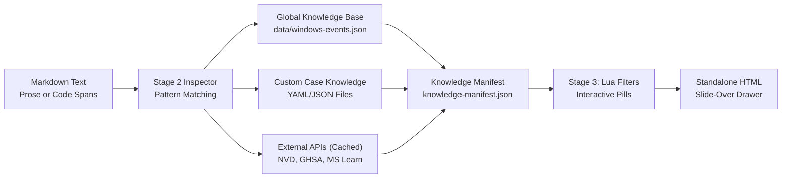

# Threat Intelligence & Knowledge Base Manual

The `md-style` toolchain includes an intelligence subsystem that automatically discovers, extracts, enriches, and tags threat indicators, forensic artifacts, and case-specific entities in Markdown reports.

---

## 1. Subsystem Overview

During Stage 2 of compilation, [`core/inspector.py`](file:///home/valor/Devel/personal/md-style/core/inspector.py) analyzes the document text, extracts candidate identifiers, queries intelligence providers, and serializes a structured JSON knowledge base. When compiled into HTML, these entities are rendered as interactive pills. Clicking a pill opens a slide-over inspector drawer displaying contextual forensic analysis.



---

## 2. Global Threat Intelligence

The global intelligence layer provides built-in definitions for industry-standard indicators without requiring any per-document configuration.

### 2.1 Windows Event IDs (`data/windows-events.json`)
The toolchain includes a built-in encyclopedia of **1,450 Windows Event IDs** across 26 log channels, ingested from the [Cyber-Experts/evtx-parser](https://github.com/Cyber-Experts/evtx-parser) project and Microsoft Learn:
- **Investigation Tips**: Tactical forensic guidance (e.g. measuring the elapsed time between EID 5001 and the subsequent EID 5000, or correlating with PowerShell script block execution).
- **Attacker Behavior**: Adversary tradecraft, attack staging, and persistence mechanisms.
- **Benign Causes**: Routine administrative operations, software deployments, and false positive patterns.
- **Key Fields**: Essential audit payload fields (e.g., `TargetUserName`, `LogonType`, `WorkstationName`, `IpAddress`).
- **MITRE ATT&CK Mapping**: Direct links to technique IDs (e.g. `T1562.001`, `T1021.001`).
- **Deep Links**: Direct URLs to `https://www.evtxparser.com/en/events/{channel}/{id}`.

### 2.2 Dynamic On-Demand Scraping & Tiered Caching
If an Event ID or EVTX log channel is not present in the local database:
1. The toolchain queries Microsoft Learn Search API and the Ultimate Windows Security Encyclopedia on-demand.
2. Parsed definitions are cached locally in `data/cache/windows-events.json`.
3. Subsequent builds reuse the cached record with **0.00s** network latency.
4. If offline or if the query fails, a structured diagnostic warning is printed, and a fallback record is generated.

### 2.3 Windows EVTX Log Channels
Recognizes standard log files and common forensic shorthand notations:
- **Canonical filenames**: `Security.evtx`, `System.evtx`, `Microsoft-Windows-Sysmon/Operational.evtx`.
- **Shorthand aliases**: `Defender.evtx`, `TerminalServices.evtx`, `LocalSessionManager.evtx`, `TaskScheduler.evtx`.
- **Collision Handling**: When an Event ID exists in multiple channels (e.g., Event ID 21 in *RDP Local Session Manager* vs. *Sysmon*), the primary definition is assigned by precedence, and alternative channels are listed under `also_in` in the drawer.

### 2.4 Vulnerability Databases (CVE & GHSA)
- **CVEs**: Identifies `CVE-YYYY-NNNN+` identifiers and queries the National Vulnerability Database (NVD) / Mitre API for CVSS scores, vulnerability descriptions, and affected CPEs.
- **GHSAs**: Identifies `GHSA-xxxx-xxxx-xxxx` security advisories and queries the GitHub Advisory database for package impact and patched versions.

### 2.5 MITRE ATT&CK Enterprise Techniques
- Matches tactic and technique identifiers (e.g. `T1059`, `T1059.001`, `T1562.001`).
- Resolves technique names, tactic categories (Execution, Defense Evasion, Persistence), and direct links to `https://attack.mitre.org/techniques/...`.

### 2.6 Cryptographic Hashes
- Recognizes MD5 (32 hex characters), SHA-1 (40 hex characters), and SHA-256 (64 hex characters).
- Enriches the drawer with direct pivots to VirusTotal and MalwareBazaar.

---

## 3. Network Indicators & OPSEC Rules

The toolchain automatically identifies IPv4 and IPv6 addresses and classifies them by network scope.

### Private RFC 1918 Subnets (Confidential Intranet)
Addresses belonging to RFC 1918 subnets (`10.0.0.0/8`, `172.16.0.0/12`, `192.168.0.0/16`) or loopback ranges (`127.0.0.0/8`) receive special OPSEC protections:
- **Badge**: `INTERNAL RFC 1918` (`.badge-internal`).
- **Policy**: Explicitly displays *“External threat queries suppressed for client confidentiality”*.
- **OPSEC Leak Prevention**: **External lookup buttons to AbuseIPDB and VirusTotal are strictly suppressed.** This guarantees that an analyst reviewing the report in a connected environment will not inadvertently leak client IP addresses to public third-party APIs.

### Public WAN IPs
Public Internet IP addresses receive external threat pivots:
- **Badge**: `PUBLIC WAN IP` (`.badge-wan`).
- **Threat Pivots**: Clickable buttons for `ABUSEIPDB LOOKUP ↗` and `VIRUSTOTAL PIVOT ↗`.

---

## 4. Indicator Syntax & Prose Formatting

Authors can reference indicators naturally in report prose without worrying about rigid formatting syntax:

### Inline Code Spans
Enclosing identifiers in standard Markdown backticks guarantees matching:
- `` `EID 5001` `` $\to$ `<code class="eventid-pill ...">EID 5001</code>`
- `` `CVE-2023-38831` `` $\to$ `<code class="cve-pill ...">CVE-2023-38831</code>`
- `` `192.168.45.10` `` $\to$ `<code class="ip-pill ...">192.168.45.10</code>`

### Unbackticked Prose with Punctuation Stripping
The Stage 3 Pandoc filter (`styles/forensic-cyber.lua`) detects indicators written directly in body paragraphs and table cells without backticks.

It automatically strips surrounding punctuation so that complex sentence structures render cleanly:
- **Parentheses**: `(Event ID 5001)` $\to$ `(<code class="eventid-pill ...">Event ID 5001</code>)`
- **Trailing Punctuation**: `EID 4624.` $\to$ `<code class="eventid-pill ...">EID 4624</code>.`
- **Brackets & Quotes**: `[EID 4625]` or `"CVE-2024-21413"` are extracted with brackets and quotation marks left outside the pill.

### Compound Lists & Slash Notation
When multiple Event IDs are referenced together, the toolchain preserves the author's exact prefix across every generated pill:
- **Compound Lists**: `Event ID 4624, 4625 and 4672` generates:
  - `<code class="eventid-pill ...">Event ID 4624</code>`
  - `<code class="eventid-pill ...">Event ID 4625</code>`
  - `<code class="eventid-pill ...">Event ID 4672</code>`
  *(Zero bare numbers are emitted)*
- **Slash Notation**: `EID 21/23` is cleanly split into two separate interactive pills:
  - `<code class="eventid-pill ...">EID 21</code> / <code class="eventid-pill ...">EID 23</code>`

---

## 5. Custom Case Knowledge Base (YAML / JSON)

Every forensic investigation involves entities unique to that specific case: compromised service accounts, domain controllers, staging directories, internal subnets, or proprietary incident malware scripts.

The **Custom Knowledge Base** subsystem allows authors to document these entities in YAML or JSON files. They are automatically highlighted in the report and rendered with custom drawer cards.

### 5.1 Knowledge File Discovery
The toolchain discovers custom knowledge files using a 4-tier search order:
1. **Explicit CLI Argument**: `uv run md-to-report document.md -k ./case-knowledge/`
2. **Document Frontmatter**:
   ```yaml
   ---
   title: "Incident Analysis Report"
   knowledge: "./fixtures/knowledge"
   ---
   ```
3. **Sibling Directory Auto-Discovery**: If a `./knowledge/` or `./kb/` folder exists alongside the Markdown file, it is loaded automatically.
4. **Parent Directory Inheritance**: In multi-report cases where reports reside in subdirectories (e.g. `cases/2026-09/0report/report.md`), the engine automatically searches parent folders (`cases/2026-09/knowledge/`) so multiple reports share a single knowledge base.

### 5.2 YAML Definition Schema
Create one or more `.yaml` files in your knowledge directory (e.g. `accounts.yaml`, `assets.yaml`, `tools.yaml`):

```yaml
- id: "svc_backup"
  name: "Backup Service Account (Compromised)"
  type: "account"
  badge: "SERVICE ACCOUNT"
  theme: "badge-account"
  patterns:
    exact:
      - "svc_backup"
      - "svc_backup@corp.internal"
    regex: "(?i)\\bsvc_backup\\b"
  in_code: true
  in_prose: true
  fields:
    "Account Role": "Automated Hyper-V & Veeam Backup Operator"
    "Privileges": "Local Administrator on all Hyper-V Cluster Nodes"
    "Kerberos": "SPN registered, vulnerable to Kerberoasting (RC4-HMAC)"
    "Incident Status": "Credentials dumped via Mimikatz sekurlsa::logonpasswords"
  investigation_tips:
    - "Inspect Kerberos TGS ticket requests (EID 4769) with encryption type 0x17 (RC4)."
    - "Verify whether password hash rotation was executed in Active Directory."
  attacker_behavior: "Adversaries leverage service account SPNs to request offline-crackable Kerberos service tickets."
  benign_causes: "Legitimate nightly backup operations initiated by the Veeam orchestrator."
  links:
    - label: "AD Security: Mitigating Kerberoasting"
      url: "https://adsecurity.org/?p=2293"

- id: "dc01_asset"
  name: "DC01.corp.internal"
  type: "host"
  badge: "PRIMARY DOMAIN CONTROLLER"
  theme: "badge-host"
  patterns:
    exact:
      - "DC01.corp.internal"
      - "192.168.45.10"
    regex: "(?i)\\bDC01\\b"
  in_code: true
  in_prose: true
  fields:
    "Operating System": "Windows Server 2022 Datacenter"
    "Role": "FSMO Role Holder (PDC Emulator, RID Master)"
    "IP Address": "192.168.45.10 / 24"
    "Forensic Status": "NTDS.dit extracted offline for analysis"
  investigation_tips:
    - "Analyze Event ID 4624 (Logon Type 10 - RemoteInteractive / Type 3 - Network) from non-standard subnets."
  links:
    - label: "Internal AD Architecture Guide"
      url: "https://wiki.internal/infra/dc01"
```

### 5.3 Schema Fields Reference

| Field | Type | Description |
| :--- | :--- | :--- |
| `id` | `string` | Unique entity identifier (used for DOM tracking and indexing). |
| `name` | `string` | Human-readable title displayed in the drawer header. |
| `type` | `string` | Entity category (`account`, `host`, `network`, `tool`, or `custom`). |
| `badge` | `string` | Pill and drawer badge text (e.g. `SERVICE ACCOUNT`, `PRIMARY DOMAIN CONTROLLER`). |
| `theme` | `string` | CSS badge color class (`badge-account`, `badge-host`, `badge-custom`, `badge-critical`). |
| `patterns.exact` | `string \| list` | One or more exact string tokens to match. |
| `patterns.regex` | `string` | Optional regular expression pattern for matching variants. |
| `in_code` | `boolean` | Set `true` to match instances inside Markdown inline code spans (`` `...` ``). |
| `in_prose` | `boolean` | Set `true` to match instances in plain paragraphs and table text. |
| `fields` | `map` | Custom key-value pairs rendered in the drawer metadata grid. |
| `investigation_tips` | `string \| list`| Forensic guidance rendered inside the `🔍 INVESTIGATION TIPS` card. |
| `attacker_behavior` | `string` | Adversary tradecraft rendered in the `⚡ ATTACKER BEHAVIOR` alert card. |
| `benign_causes` | `string` | Normal administrative explanations rendered in the `ℹ️ BENIGN CAUSES` card. |
| `links` | `list` | Documentation or internal wiki links (`label` and `url`). |

---

## 6. Slide-Over Inspector Drawer UI

When viewing the compiled HTML report in any modern browser, clicking any pill slides open the inspector drawer (`#cyber-drawer`):

- **Clean-Slate DOM Architecture**: Each click performs a clean-slate DOM reset, hiding all metadata rows before displaying fields relevant to the selected indicator type.
- **Dynamic Field Rows**: Displays MITRE technique mappings, affected software, key audit fields, and custom key-value pairs.
- **Threat Pivots**: Context-sensitive external buttons linking directly to authoritative registries (evtxparser.com, NVD, MITRE ATT&CK, VirusTotal, AbuseIPDB).
- **Keyboard Navigation**: Pressing <kbd>Esc</kbd> closes the drawer. Clicking outside the drawer closes it automatically.

---

## 7. Build Diagnostics & Unresolved Indicators

When indicators cannot be verified against knowledge sources (e.g., offline build environments or unrecognized IDs):

1. **Terminal Diagnostics**: Stage 2 prints an actionable warning during build:
   ```text
   [WARNING] 2 threat indicator(s) could not be verified from knowledge sources:
     ⚠ CVE-2099-99999: CVE not found in vulnerability databases or offline build
     ⚠ EID 99999: Event ID not found in security encyclopedias
   ```
2. **In-Document Alert Banner**: When clicking an unverified pill in the report, the drawer displays `#drawer-unresolved-banner` informing the reader that the entity could not be verified offline and provides direct web search buttons.
