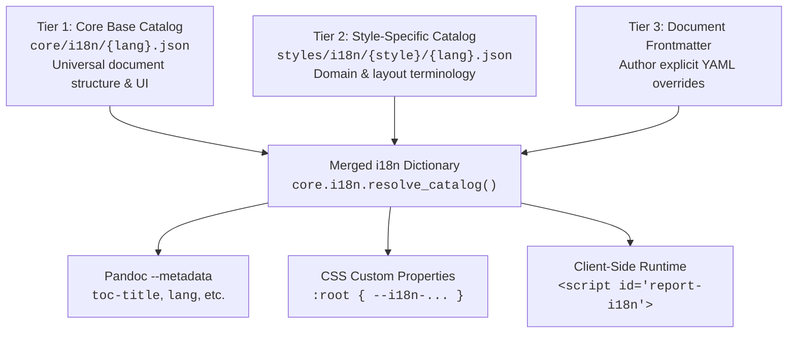

# Localization & Internationalization (i18n)

The `md-style` toolchain features a 3-tier cascading localization framework that delivers translated strings across Python orchestration, Pandoc document metadata, CSS custom properties, and client-side JavaScript.

---

## 1. The 3-Tier Cascading Hierarchy

When generating a document, [`core/i18n/__init__.py`](file:///home/valor/Devel/personal/md-style/core/i18n/__init__.py) merges three layers of localization into a single canonical dictionary:



### Tier 1: Core Base Catalogs (`core/i18n/`)
Defines language dictionaries for universal document structures and standard UI controls. Supported languages: `en.json`, `cs.json`, `sk.json`, `de.json`.

```json
{
  "toc_title": "Table of Contents",
  "figure_label": "Figure",
  "table_label": "Table",
  "confidential_label": "CONFIDENTIAL",
  "page_prefix": "Page ",
  "page_of": " of ",
  "filter_placeholder": "Filter indicators...",
  "copy": "Copy",
  "copied": "Copied!"
}
```

### Tier 2: Style-Specific Catalogs (`styles/i18n/`)
Enriches the base vocabulary with specialized terminology required by individual style families:
- **`styles/i18n/forensic-cyber/`**: Cyber incident report labels (`Zpráva z vyšetřování kybernetického incidentu`, `Inspektor kybernetických indikátorů`, `Vyšetřovací tipy`, `Chování útočníka`).
- **`styles/i18n/forensic/`**: Formal evidence dossier headers (`Znalecký posudek`, `Řetězec úschovy důkazů`, `Kryptografický otisk`).
- **`styles/i18n/svj/`**: Homeowners association terms (`Hlasovací lístek shromáždění`, `Usnášeníschopnost`, `PRO / PROTI / ZDRŽEL SE`).
- **`styles/i18n/announcement/`**: Memorandum labels (`MEMORANDUM`, `DŮLEŽITÉ UPOZORNĚNÍ`).
- **`styles/i18n/school/`**: Academic grading and course terms (`HODNOCENÍ`, `Školní zpráva`).

### Tier 3: Document Frontmatter Layer
Authors can override any individual token directly in their Markdown YAML frontmatter:
```yaml
---
title: "Forenzní analýza infrastruktury"
language: cs
classification: "PŘÍSNĚ TAJNÉ"
examiner-label: "VEDOUCÍ VYŠETŘOVATEL:"
toc-title: "Obsah zprávy"
---
```
Frontmatter keys override both the style catalog and core catalog.

---

## 2. Language Code Normalization

The engine accepts standard ISO 639-1 language codes, BCP 47 tags, and locale strings in document frontmatter:
- `language: cs`
- `lang: cs_CZ`
- `language: en-US`

The engine uses Python's `babel.Locale` to parse and normalize tags to standard base codes (`cs_CZ` $\to$ `cs`). If a requested language dictionary is unavailable, it gracefully falls back to English (`en`).

---

## 3. Polyglot Delivery

Once the three tiers are merged into the final dictionary, the engine distributes localized tokens across four consumer targets:

### 3.1 Pandoc Metadata
Standard document tokens (such as `toc-title`) are passed directly to Pandoc via `--metadata toc-title="..."`. This ensures Pandoc's internal table of contents generator emits properly translated headings without requiring custom template hacks.

### 3.2 CSS Custom Properties Injection
The dictionary is serialized into CSS variables and injected into the document `<head>`:
```css
:root,
:root:lang(cs),
html[lang^="cs"] {
  --i18n-toc-title: "Obsah";
  --i18n-figure-label: "Obrázek";
  --i18n-table-label: "Tabulka";
  --i18n-confidential-label: "DŮVĚRNÉ";
  --i18n-page-prefix: "Strana ";
  --i18n-page-of: " z ";
  --i18n-investigation-tips: "VYŠETŘOVACÍ TIPY";
  --i18n-attacker-behavior: "CHOVÁNÍ ÚTOČNÍKA";
}
```
Stylesheets consume these variables with `var(--i18n-...)`.

### 3.3 Client-Side Runtime (`#report-i18n`)
The entire JSON catalog is embedded directly into the standalone HTML file:
```html
<script id="report-i18n" type="application/json">
{
  "filter_placeholder": "Filtrovat indikátory...",
  "copy": "Kopírovat",
  "copied": "Zkopírováno!",
  "investigation_tips": "VYŠETŘOVACÍ TIPY",
  "attacker_behavior": "CHOVÁNÍ ÚTOČNÍKA"
}
</script>
```
JavaScript components (such as the cyber inspector drawer and search filters) consume these strings via `getUiStrings()`, ensuring that dynamic UI elements match the document language without external requests.

---

## 4. Architectural Post-Mortem: Elimination of CSS `:root:lang()`

### The Legacy Prototype Flaw
Earlier versions implemented localization by declaring hardcoded strings directly in CSS:
```css
/* ANTIPATTERN (REMOVED) */
:root:lang(cs) {
  --i18n-header-badge: "OFICIÁLNÍ ZPRÁVA";
  --i18n-classification: "DŮVĚRNÉ";
}
```

### Why This Was Purged
1. **CSS Specificity Conflicts**: `:root:lang(cs)` carries a specificity of `(0, 1, 1)`, whereas generic `:root` carries `(0, 1, 0)`. When an author attempted to override `--i18n-classification` in frontmatter or custom styles, the override failed unless written with higher specificity.
2. **Duplication & Drift**: Translating a report into German or Slovak required manually editing 6 different CSS files.
3. **No JavaScript Sharing**: Interactive JavaScript elements (drawer headers, search placeholders, copy buttons) could not access strings defined inside CSS pseudo-selectors.

**Current Rule**: Stylesheets must never declare `:root:lang()`. All localization is centralized in JSON catalogs.

---

## 5. Adding a New Language

To add support for a new language (e.g. French, `fr`):

1. **Create Core Catalog**:
   Create `core/i18n/fr.json` containing base document tokens.
2. **Create Style Catalogs**:
   Create `styles/i18n/forensic-cyber/fr.json` (and other relevant themes) with domain translations.
3. **Compile**:
   Set `language: fr` in your document frontmatter. The engine will automatically detect, merge, and inject the French catalogs.
