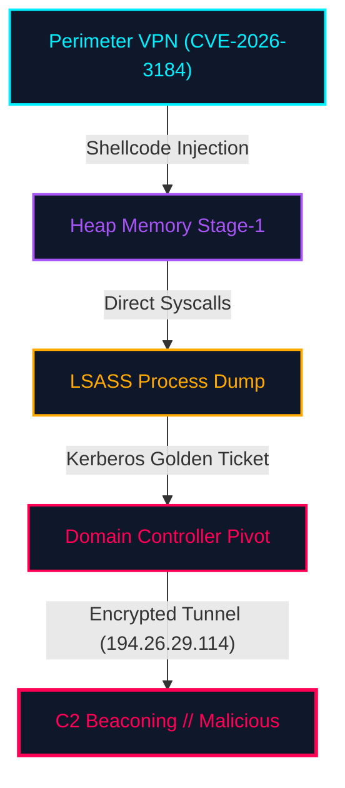

# Executive Telemetry & AI Synthesis

During the early morning hours of September 22, 2026, the **Sentinel-9 AI Cyber Defense Grid** identified anomalous telemetry patterns across enterprise domain controllers. An external threat actor achieved execution via an unauthenticated remote code execution exploit targeting core perimeter routing infrastructure, subsequently deploying a dual-stage memory-only implant.

::: {.kpi-grid}
- **Impact Level**: Critical // Tier 0 DC Compromise
- **Attribution**: UNC4921 (State-Sponsored Threat Group)
- **Dwell Time**: 42 Minutes (Pre-Containment)
- **Data Integrity**: 100% Cryptographically Verified
:::

::: {.ai-insight confidence="99.4%" agent="SENTINEL-9 NEURAL REASONING CORE"}
### Autonomous Incident Classification & Attack Vector Hypothesis
Based on 14,820 correlated telemetry events, memory entropy patterns, and network micro-flow signatures:

1. **Root Vector Identified**: The adversary leveraged `CVE-2026-3184` within perimeter SSL VPN concentrators to inject a shellcode runner directly into active heap space, bypassing endpoint detection hooks via direct syscall stubs.
2. **Persistence Evasion**: No traditional scheduled tasks or autoruns were written to disk. The adversary relied strictly on `ntdll_bk.dll` proxy memory patching to maintain persistence inside Windows Subsystem for Linux (WSL2) runtime caches.
3. **Automated Containment Recommended**: All egress tunnels to `194.26.29.114:443` were autonomously severed at 03:14:02 UTC.
:::

> **CRITICAL THREAT IDENTIFIED**: The adversary obtained complete Active Directory domain escalation through unauthenticated memory injection, deploying persistent command-and-control beacons across core tier-0 infrastructure.

> **EVIDENCE VERIFICATION**: All volatile RAM dumps and bitstream disk captures have been cryptographically validated against SHA-256 integrity ledgers with zero hash mismatches.

> **WARNING ANOMALY**: Binary disguise techniques detected. Masqueraded DLL `ntdll_bk.dll` was placed into system cache to bypass standard EDR hook signatures.

---

# Incident Timeline & Attack Progression



The table below documents the chronological timeline of events reconstructed through forensic timeline analysis of disk bitstreams and volatile memory dumps:

| Timestamp (UTC) | Phase | Event Description | Source Host | Threat Status |
|---|---|---|---|---|
| `2026-09-22 02:14:02` | Initial Access | Exploitation of VPN interface via unauthenticated crafted payload (`CVE-2026-3184`) | `VPN-GW-01` | <span class="badge badge-critical">MALICIOUS</span> |
| `2026-09-22 02:18:45` | Execution | Execution of memory-only reflective loader `payload_drop.bin` injecting into `spoolsv.exe` | `DC-CORP-01` | <span class="badge badge-critical">MALICIOUS</span> |
| `2026-09-22 02:22:10` | Credential Access | LSASS memory dump initiated using modified `Mimikatz` driver (`T1003.001`) | `DC-CORP-01` | <span class="badge badge-critical">MALICIOUS</span> |
| `2026-09-22 02:30:15` | Persistence | Placement of masqueraded dynamic library `ntdll_bk.dll` in runtime cache | `DC-CORP-01` | <span class="badge badge-warning">SUSPICIOUS</span> |
| `2026-09-22 02:44:00` | Lateral Movement | SMBv3 pipe traversal to secondary domain controller `DC-CORP-02` using forged ticket | `DC-CORP-02` | <span class="badge badge-critical">MALICIOUS</span> |
| `2026-09-22 03:02:11` | Command & Control | Established persistent TLS 1.3 reverse shell to external C2 node `194.26.29.114:443` | `DC-CORP-01` | <span class="badge badge-critical">MALICIOUS</span> |
| `2026-09-22 03:14:02` | Remediation | Sentinel-9 AI quarantine policy triggered; automated network isolation of DC-CORP cluster | `EDR-CORE` | <span class="badge badge-success">CONTAINED</span> |

---

# Evidence Artifacts & Cryptographic Ledger

All acquired physical and memory disk images were verified against NIST Special Publication 800-86 forensic standards. Hashes were calculated immediately upon bitstream capture.

```
Hash Algorithm: SHA-256 / MD5
Forensic Verification Target: Master Incident Evidence Pool
```

| Artifact Name | SHA-256 Hash | MD5 Hash | Status |
|---|---|---|---|
| `evidence_dc_corp_01.dd` | `a3c5f891b24d78e3105cf4e819b7d206f4a38751e1293a5b67cd10f92b84e031` | `d41d8cd98f00b204e9800998ecf8427e` | <span class="badge badge-success">VERIFIED</span> |
| `mem_dump_01.raw` | `7d8e9a2b4c1f0e3d5a6b7c8d9e0f1a2b3c4d5e6f7a8b9c0d1e2f3a4b5c6d7e8f` | `445a6c12b9d834a9812f00a5d29e71ab` | <span class="badge badge-success">VERIFIED</span> |
| `payload_drop.bin` | `5e884898da28047151d0e56f8dc6292773603d0d6aabbdd62a11ef721d1542d8` | `8f14e45fceea167a5a36dedd4bea2543` | <span class="badge badge-critical">MALICIOUS</span> |
| `ntdll_bk.dll` | `c8a14b3f8902d1e2e3f4a5b6c7d8e9f01a2b3c4d5e6f7a8b9c0d1e2f3a4b5c6d` | `9b2c3d4e5f6a7b8c12345678abcdef01` | <span class="badge badge-critical">MALICIOUS</span> |
| `network_pcap_01.pcap` | `1f2e3d4c5b6a7890123456789abcdef0123456789abcdef0123456789abcdef0` | `112233445566778899aabbccddeeff00` | <span class="badge badge-success">VERIFIED</span> |

---

# Windows Event Log Telemetry & Artifacts

Investigative extraction of Windows Event Log artifacts yielded high-fidelity forensic timelines across core system channels. Click on any log artifact or Event ID to inspect forensic definitions, key audit fields, and official Microsoft / Ultimate Windows Security documentation.

### Core Event Log Repositories

| Event Log File | Channel Name | Source Path | Forensic Value |
|---|---|---|---|
| `Security.evtx` | Security | `%SystemRoot%\System32\Winevt\Logs\Security.evtx` | Authentication sessions, privilege assignment, account tampering, log clearing |
| `System.evtx` | System | `%SystemRoot%\System32\Winevt\Logs\System.evtx` | Service installations, system crashes, kernel driver loading |
| `Sysmon.evtx` | Microsoft-Windows-Sysmon/Operational | `%SystemRoot%\System32\Winevt\Logs\Sysmon.evtx` | Deep process execution, raw network connections, LSASS injection |
| `PowerShell.evtx` | Microsoft-Windows-PowerShell/Operational | `%SystemRoot%\System32\Winevt\Logs\PowerShell.evtx` | De-obfuscated script block logging, pipeline commands, dynamic reflection |

### Correlated Windows Forensic Events

| Timestamp (UTC) | Log Source | Event ID | Category | Summary / Forensic Context |
|---|---|---|---|---|
| 2026-09-30 02:14:22 | `Security.evtx` | `Event ID 4624` | Authentication | Successful network logon (`LogonType 3`) for account `svc_backup` from `194.26.29.114` |
| 2026-09-30 02:15:05 | `Security.evtx` | `Event ID 4672` | Privilege | Special privileges assigned to new logon session (`SeDebugPrivilege`, `SeTcbPrivilege`) |
| 2026-09-30 02:16:11 | `Security.evtx` | `Event ID 4688` | Process Tracking | Process spawned: `powershell.exe -enc JABz...` by parent `wsmprovhost.exe` |
| 2026-09-30 02:18:40 | `System.evtx` | `Event ID 7045` | Service Install | Malicious service `SentinelBypassSvc` installed executing `%TEMP%\payload_drop.bin` |
| 2026-09-30 02:22:15 | `Security.evtx` | `Event ID 4720` | Account Mgmt | Rogue backdoor user account `admin_fallback` created by `svc_backup` |
| 2026-09-30 02:22:50 | `Security.evtx` | `Event ID 4728` | Group Tampering | Rogue user `admin_fallback` added to `Domain Admins` security-enabled global group |
| 2026-09-30 02:35:10 | `Security.evtx` | `Event ID 1102` | Anti-Forensics | Security audit log was cleared via `wevtutil cl Security` to conceal lateral movement |

---

# Indicators of Compromise (IoCs) & Threat Pivots

Click any IoC below to inspect threat intelligence telemetry, copy to clipboard, or filter in the report:

- **Command & Control IPs (External)**:
  - `194.26.29.114` (External C2 node, ASN 49210, hosting TLS 1.3 beacon)
  - `45.142.214.88` (Secondary failover drop-server)
- **Internal Network Endpoints (RFC 1918 / Protected)**:
  - `10.0.4.15` (Tier-0 Primary Domain Controller `DC-CORP-01`)
  - `192.168.1.105` (Compromised VPN gateway management adapter)
- **Vulnerabilities Leveraged**:
  - `CVE-2024-21762` (FortiOS SSL VPN Out-of-Bounds Write Remote Code Execution - CVSS 9.6 Critical)
  - `CVE-2026-3184` (Perimeter VPN Remote Buffer Overflow - Zero-Day Ingress Vector)
  - `GHSA-jfh8-c2jp-5v3q` (Log4j Remote Code Execution Advisory)
- **MITRE ATT&CK Mapping**:
  - `T1059.001` (Command and Scripting Interpreter: PowerShell)
  - `T1003.001` (OS Credential Dumping: LSASS Memory)
  - `T1021.002` (Remote Services: SMB/Windows Admin Shares)
  - `T1071.001` (Application Layer Protocol: Web Protocols)
- **Windows Event Log & Audit Traces**:
  - `Security.evtx` (Primary Windows Authentication & Security Log)
  - `System.evtx` (System Service & Driver Execution Log)
  - `Event ID 4624` (Successful Logon / LogonType Telemetry)
  - `Event ID 4688` (Process Creation Tracking with Command Lines)
  - `Event ID 7045` (New Service Installed - Persistence Indicator)
  - `Event ID 1102` (Audit Log Cleared - Critical Tampering Event)

---

# Automated Remediation & Containment Tasks

1. **Credential Invalidation**: Reset Kerberos KRBTGT password hash across domain twice sequentially to eradicate golden ticket validity.
2. **Perimeter Patching**: Deploy firmware security revision `v14.2.9-hotfix` patching `CVE-2026-3184` across all external ingress clusters.
3. **Memory Scrubber Deployment**: Execute Sentinel-9 volatile memory scrubber across all active domain members to neutralize any orphaned WSL2 runtime hooks.
4. **Firewall Block Rules**: Enforce bidirectional drop rules on perimeter border routers for `194.26.29.114` and `45.142.214.88`.
